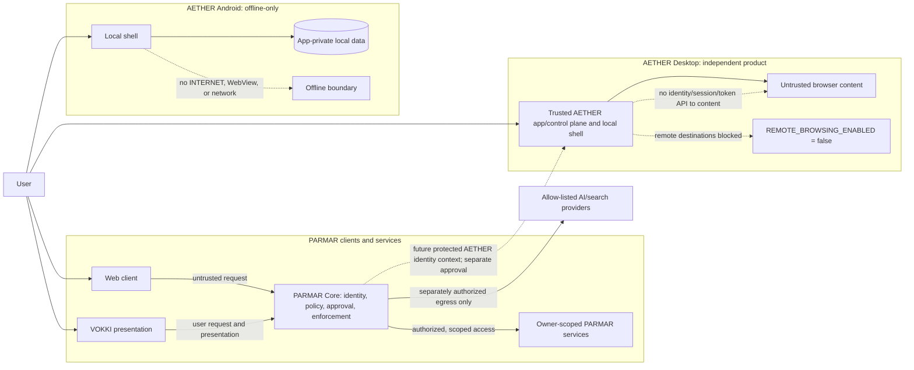
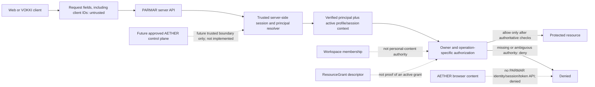

# PARMAR Infinite — Consolidated Master Vision and Requirements

| Field | Value |
|---|---|
| Status | **Authoritative consolidated product-requirements baseline and execution roadmap; no implementation or release authorization** |
| Scope | PARMAR ecosystem, including PARMAR Core, VOKKI, AETHER boundaries, and web/native client requirements |
| Mode | Documentation only. This document does not authorize implementation, provider selection, production authentication, network enablement, or release. |
| Evidence basis | Current repository source and documentation, plus the product directions already recorded in the VOKKI Master PRD and identity/tenancy ADR |
| Authority | This is the umbrella vision and roadmap. Existing approval records remain authoritative for their exact decisions; this document does not supersede or silently amend them. |

> **Review boundary:** “Approved” means the product/security requirement was previously approved, not that implementation, runtime behavior, a vendor, or release has been approved. Proposed options in this document are design requirements for review, not available application features. Current source evidence is not a browser/device certification.

## A. Consolidated Master PRD

### 1. Vision

PARMAR is a human-governed AI decision-support ecosystem. **PARMAR Core** owns identity-aware policy enforcement, risk review, authorization, approval records, permitted action boundaries, independent verification, and authoritative audit. **VOKKI** is the user-facing assistant and communication interface to PARMAR; it does not own policy or approval authority. **AETHER** is an independent product and security boundary. Its browser capabilities never imply PARMAR or VOKKI authority.

The product should let users choose how PARMAR looks and how they navigate it, while preserving a recognizable PARMAR identity, VOKKI’s canonical identity/personality/voice, accessibility, data ownership, and security properties. Users may choose among supported local or external AI routes only when the server configuration, scoped consent, and security gates allow them. No theme, layout, model, workflow, provider, or platform is mandatory for every user.

### 2. Product boundaries and non-negotiable invariants

1. PARMAR Core remains the only authority for policy, risk, authorization, approval, enforcement, and release decisions.
2. User approval authorizes only the exact, bounded, owner-scoped operation in the server-side approval record. Approval is not execution or proof of success.
3. VOKKI presents PARMAR state and released responses. Its visual, voice, personality, avatar, and customization settings cannot change PARMAR decisions.
4. Models, memory, retrieved research, documents, plugins, and connector output are untrusted data. They cannot grant permissions, create approval, change policy, or directly invoke side effects.
5. Authentication is established server-side. Browser-supplied identity, owner, role, or profile identifiers are never proof of authority.
6. User, account, profile, workspace, session, conversation, memory, approval, and audit ownership are checked at the relevant server boundary. Missing or ambiguous ownership denies protected access.
7. External data transfer requires explicit, scoped consent immediately before egress. Server configuration is not user consent. Denial, failure, or revocation has no silent provider fallback.
8. Local Demo is clearly identified as deterministic demo behavior, not a local AI model, production account, verified identity, or provider inference.
9. Capability labels distinguish implemented, planned, unavailable, simulated/local demo, requires approval, and awaiting independent verification.
10. Preserve the original PARMAR logo and the canonical VOKKI identity. Customization may change user-approved presentation, not silently replace or overwrite those canonical assets/identities.
11. AETHER remains separate. Keep `REMOTE_BROWSING_ENABLED=false` until independent isolation verification and a separate recorded authorization pass. AETHER Android remains strictly offline.
12. No UI success state may be shown until the relevant server/platform operation is confirmed. Unknown or partially completed operations remain explicitly unknown.

### 3. Users, ownership, and permissions

#### 3.1 Identity and authorization

- One PARMAR account and PARMAR-wide sign-on are the approved long-term direction; do not create separate VOKKI or AETHER identities.
- A future protected AETHER application/control-plane surface uses the shared PARMAR account only through an approved trusted boundary. AETHER browser content receives no PARMAR identity, session, or token, and shared sign-on grants no browsing authority. This requirement does not authorize an AETHER authentication integration.
- The authentication provider, protocol, recovery channels, assurance thresholds, and production rollout remain unselected and gated.
- Account recovery must support passkeys, additional verification, login-attempt limits, and lost-device protection. Secure per-device sessions must include a device inventory, individual-device and all-device remote logout, and step-up verification where appropriate for sensitive actions.
- Exact recovery methods, verification assurance, thresholds, session lifetime/rotation, device metadata, step-up triggers, and revocation latency remain decision-gated; the approved protections do not select their implementation.
- Profiles remain owner-controlled. Multiple-profile and family/team modes are eventual scope, not authorization to enable sharing now.
- Workspace membership does not grant access to personal content. Any future sharing requires an explicit, revocable owner grant with defined View/Edit/Manage operation semantics.
- Until an authoritative grant evaluator and route-by-route enforcement are implemented and tested, non-owner access is denied. Workspace membership or a `ResourceGrant` descriptor alone is not proof of authority.
- A session or selected profile is context, not permission by itself. Each protected operation checks live server-side ownership and authorization.
- Anonymous Local Demo and any unverified development identity remain visibly distinct from a verified production account.

#### 3.2 User-granted capability permissions

Every permission is specific to a capability and purpose, is requested at point of use, names the data and recipient, and can be reviewed and revoked. Permission categories include:

| Permission category | Required scope and controls |
|---|---|
| External AI | Provider/model or provider class, purpose, data categories, locality/retention disclosures, per-request or explicitly bounded consent, and revocation. |
| Research/search | Search provider, query and context sent, sources returned, purpose, and retention. Research permission does not authorize general browsing. |
| Memory | Separate consent for capture and retrieval, with review, correction, export, delete, clear, reset, and truthful retention state. |
| Files/media | Explicit file/capture selection, supported type/size, local/cloud processing, data transferred, derived outputs, and cleanup. Camera, microphone, audio, image, and video permissions are separate. |
| Voice | Push-to-talk activation, microphone/speech runtime, transcript/audio policy, output voice and captions. Wake-word/background listening requires separate approval and security gates and is off by default. |
| Plugins/connectors | Named connector, requested data/action scopes, credential access, destination, duration, and revocation. Registry presence is not executable authorization. |
| Notifications/proactive behavior | Per-channel opt-in, timing/quiet hours, lock-screen privacy, rate controls, and an immediate disable path. |
| AETHER site/device capabilities | Separate AETHER controls and platform permissions; PARMAR/VOKKI permission never grants browser, site, or OS access. Remote browsing remains disabled pending independent gates. |
| Accessibility/personalization | User-owned presentation preferences only. These settings cannot modify policy, permissions, identity ownership, or approval requirements. |

PARMAR policy and security controls are not user-configurable bypass switches. Users can choose among capabilities already approved and available to their identity/platform, but cannot lower mandatory safeguards.

### 4. Product capability requirements

#### 4.1 PARMAR Core and governance

- Provide a comprehensible request review: intent, risk, policy outcome, rationale, data scope, required permissions, and next user decision.
- Keep review, enforcement, and release states distinct from VOKKI presentation and provider output.
- An approval is server-side, expiring, one-use, integrity protected, and bound to the exact user/session/profile/resource, action parameters, destination, and scope.
- Recheck authorization and policy at the action boundary. Changed parameters require a new review/approval.
- Separate execution from approval; use least privilege, idempotency, cancellation, reconciliation, and independent result evidence.
- Report completed only after separately authorized evidence confirms the exact operation. Report failed, blocked, cancelled, or unknown honestly.
- Keep an append-only or otherwise tamper-evident audit design as a production requirement; current local audit source is not proof of durable tamper resistance.

#### 4.2 VOKKI

- Provide a dedicated workspace and a discoverable PARMAR-wide entry/presence surface where supported. Presence is not hidden listening or background execution.
- Preserve the canonical VOKKI identity, portrait/asset provenance, personality and canonical voice identity.
- Support text as a full interaction path. Push-to-talk is the initial voice direction where the browser/OS/runtime and consent permit it.
- Render real PARMAR lifecycle and release states; facial expression, voice, animation, or tone must not imply a different safety or approval state.
- Offer appearance and environment customization as described in the selectable customization matrix below, without replacing the canonical identity.
- Keep conversational response presentation controls separate from personality, policy, and model authority. Custom instructions are untrusted, user-scoped presentation guidance and never override PARMAR policy.
- Camera reference capture is separately user-initiated, permissioned, local-scope disclosed, and never replaces VOKKI’s canonical portrait.
- Floating/overlay presence is optional and platform-specific. It must remain accessible and user initiated; do not claim interactive floating chat/voice where only a launcher exists.

#### 4.3 AETHER

- AETHER remains an independent product and security boundary. A future protected AETHER application/control-plane surface may use the shared PARMAR account through an approved Core boundary; the browser renderer/content must not receive PARMAR identity, authentication, session, or token APIs. Sign-on does not grant AETHER browsing authority.
- Preserve AETHER’s original visual identity and product assets; do not merge browser identity with PARMAR branding or VOKKI.
- Desktop restricted mode may expose implemented local shell controls, including local tabs and local new-tab navigation. Remote website navigation/search and network access, downloads, site permissions, and networked integrations remain unavailable. Keep `REMOTE_BROWSING_ENABLED=false` until independent containment and separate authorization gates pass.
- Android is an offline local-data shell: no `INTERNET` permission, WebView, networking implementation, cloud sync, or implication that remote sites are accessible. Bookmarks and tab descriptors are local; saved-URL tabs are metadata only and never load a site. History and Downloads remain empty, and Settings has no functional preference unless separately implemented and verified.
- iOS and cross-platform parity remain unclaimed until platform-specific implementation and acceptance exist.
- A PARMAR VOKKI entry embedded in a PARMAR AETHER surface does not create a VOKKI dependency in standalone AETHER applications.

#### 4.4 AI orchestration and providers

- Preserve a provider-neutral interface and server-side provider configuration. Local Demo, local model inference, and external inference are distinct states.
- Support the design choices **Local-only**, **external-only**, and **hybrid with explicit user-visible routing** only when their respective runtimes, policies, and consent gates exist. Users do not have to select one global route if individual capabilities differ.
- Per-request routing may consider capability, user choice, data locality, consent, availability, cost, latency, and policy. It must not silently fall back across locality or consent boundaries.
- Treat provider output as untrusted. Validate schemas, apply PARMAR response-safety checks, and release only authorized output.
- Local AI is a long-term direction, not a current capability claim. Compare embedded/on-device runtimes, device-local services, OS inference services, and network-reachable services separately. Never label LAN/cloud inference “on-device.”
- External integrations/providers may be selectable only from a server-owned, allow-listed inventory; client inputs cannot set endpoint URLs, models, adapters, or credentials.

#### 4.5 Memory and data

- Keep conversation history, durable memory, settings, VOKKI appearance assets, AETHER data, approvals, and audit as distinct data classes with explicit owners and lifecycle policies.
- Memory is user-scoped by default; no implicit profile/workspace sharing or migration.
- Automatic memory is an approved product direction only after explicit consent, provenance, review/edit/export/delete/reset, and ownership/isolation gates pass. Consent revocation is not deletion.
- Never infer training consent from memory consent. Model training on user content is disabled absent a separate approved product and privacy decision.
- Define storage location, encryption, key ownership, retention, export, deletion, backup expiry, sync, and provider-transmitted data limitations for each persistent class before enabling it.
- Reset actions are narrow and labeled: restore appearance defaults, restore all local preferences, clear a chosen local cache/history class, clear selected memory, revoke permissions, sign out, or request account closure. No broad “reset” may silently delete unrelated data or imply deletion where only local UI state was cleared.

#### 4.6 Projects, documents, and media

- Provide user-selected projects/workspaces for document organization, search, summaries, and task status only where the relevant capability is implemented and authorized.
- Show exactly which files and context will be used before sending them to AI or tools. Do not provide generic access to local-device files.
- Define allow-listed formats, size/page/token limits, safe parsing, indexing, version identifiers, provenance, workspace authorization, storage, export, deletion, and backup behavior before enabling file processing.
- Document understanding is the baseline direction. Image, audio, and video understanding are separate optional capabilities; camera or microphone permission, file selection, or model metadata does not enable them implicitly.
- Before enabling each media type, define supported formats/limits, explicit selection and permission, local versus cloud processing, provider/purpose/data disclosure and consent, derived-output provenance, retention, export/deletion, and release evidence.
- Unsupported, corrupt, encrypted, oversized, or untrusted inputs are rejected or quarantined with an actionable explanation. Partial processing must not be presented as complete.

#### 4.7 Device awareness and proactive notifications

- Request microphone, camera, screen/application capture, files, notifications, and device signals separately and at point of use.
- Screen/application awareness is opt-in per session and per capture. Show the active source, content scope, purpose, destination, duration/retention, and an immediate stop control. No hidden or continuous monitoring is implied.
- Revoke capture permission on user request and at applicable logout/session/app-lifecycle boundaries. Permission denial, revocation, or API unavailability leaves the capability off; never silently substitute another sensor or channel.
- Proactive suggestions and notifications are separately opt-in, explainable, dismissible, rate-limited, and configurable by channel, quiet hours, do-not-disturb, and lock-screen privacy. Page-visible speech is not an OS notification or background activity.
- Notification delivery cannot approve a task or imply completion. Deduplicate as specified by an approved policy; revoked/unavailable channels remain off rather than falling back silently.
- The current Phone Awareness behavior is a simulation, not device awareness. Native capture and OS notification capabilities require separate platform implementation and acceptance.

#### 4.8 Guide, Execute, and Orchestrate modes

- **Guide** explains, drafts, analyzes, and suggests; it has no external side effects.
- **Execute** performs only a user-authorized, narrowly scoped task through an approved executor, with previews and exact approval when required.
- **Orchestrate** coordinates bounded multi-step work with a visible plan and task state; PARMAR governance is rechecked at each consequential boundary.
- Mode changes, capability limits, and required approvals are visible before action. A mode label never implies an unimplemented capability.
- Keep planning separate from execution. No model-generated tool call directly invokes an adapter. Persist exact action parameters and approval bindings server-side; enforce least privilege, step limits, deadlines, idempotency, cancellation, recovery, audit, and independent outcome verification.
- Guide acceptance proves zero executor calls. Execute/Orchestrate side effects require authorization, scoped approval when required, and auditable results; altered parameters, replay, wrong owner, expired tasks, and uncertain outcomes must not expand authority or be reported as success.

#### 4.9 Research, simulation, tools, automation, and plugins

- Research is a distinct, explicitly requested and authorized capability. Sources are validated and labeled as provenance, not proof; do not claim factual verification without claim-to-source evaluation.
- Simulation uses synthetic/local scenarios and clearly states that no real-world action occurs.
- Tool/plugin catalogues distinguish metadata, installed, available, configured, authorized, active, healthy, and verified states. Metadata does not execute.
- Any future connector runs through a PARMAR broker, with scoped permissions, secret isolation, sandboxing, quotas, audit, revocation, and independent tests.
- General automation is not available until a task state machine, action boundary, scoped approval, executor isolation, independent verification, cancellation, recovery, and audit are implemented and accepted.
- No automation, provider, or plugin can approve its own work or bypass human review.

#### 4.10 Architecture diagrams

These diagrams express required trust boundaries and future gated flows; they do not claim that every connection or capability is implemented.

**Ecosystem and platform boundaries**



**Identity and authorization trust boundaries**



**Approval-to-execution lifecycle**

```mermaid
sequenceDiagram
  actor User
  participant V as VOKKI or client
  participant C as PARMAR Core
  participant A as Approval store
  participant E as Future gated executor
  participant Vfy as Independent verifier

  User->>V: Submit request
  V->>C: Request with untrusted client context
  C->>C: Resolve server principal; review policy, ownership, scope
  alt Human approval required
    C->>A: Persist exact, expiring, one-use approval
    C-->>V: Show exact operation and decision
    User->>V: Approve or reject
    V->>C: Return approval decision
  else Human approval not required by policy
    C-->>V: Show policy outcome and bounded operation
  end
  C->>C: Recheck session, owner/profile, policy, parameters, expiry, replay
  alt Denied, stale, changed, or rejected
    C-->>V: Denied; no side effect
  else Authorized and approval valid if required
    Note over C,E: Approval is not execution; executor is future gated and not generally implemented
    C->>E: Dispatch only the exact authorized operation
    E-->>C: Execution outcome or unknown
    C->>Vfy: Request independent outcome evidence
    Vfy-->>C: Verified result or unavailable/unknown
    C-->>V: Report verified, failed, cancelled, or unknown
  end
```

### 5. Cross-platform scope

Each client has an independent support matrix and release gate. Shared requirements do not imply shared implementation or parity.

| Client | Product requirement | Safe current interpretation |
|---|---|---|
| Web | Responsive PARMAR/VOKKI experience, governed APIs, accessible layouts, user preferences, and explicit capability/error states. | Existing web UI and backend source exist. Runtime, mobile-browser, production identity, and release acceptance are separate and unverified. |
| Desktop | A separately approved VOKKI client is possible; AETHER desktop remains independent and restricted. | AETHER has an Electron restricted shell; it is not a VOKKI desktop client. Remote browsing remains disabled. |
| Android | Native PARMAR/VOKKI client only by separate approval; AETHER Android stays offline and local-only. | AETHER Android source has local bookmarks and tab metadata; saved-URL tabs never load pages. History and Downloads are empty and Settings has no functional preference. Build/device acceptance is unverified. It is not a VOKKI client. |
| iOS | Native client only after separate platform, identity, privacy, accessibility, and security decisions. | Implementation is documented as not started; no parity claim. |
| Offline | State which features work offline, what remains local, what is unavailable, and whether any draft is queued. | AETHER Android has an offline-only contract. VOKKI local AI, offline sync, and safe cross-device synchronization are not verified. No side-effecting operation may auto-replay. |

## B. Complete UX and design architecture

### 6. Information architecture and navigation choices

The following navigation models are selectable product options, not a mandate to show all of them simultaneously. Users can choose any supported model and retain a consistent destination map.

| Navigation option | Intended availability/behavior |
|---|---|
| Expanded sidebar | Desktop/tablet workspace labels and navigation. |
| Collapsed icon rail | Desktop compact mode; every icon has an accessible name and tooltip. |
| Mobile drawer | Small-screen “More” menu with focus management, close/back behavior, and no content trapped behind it. |
| Bottom navigation | Small-screen primary shortcuts; user may choose which destinations appear when supported. |
| Top tabs | Optional task/workspace switching on wide layouts; not a replacement for accessible global navigation. |
| Breadcrumbs | Context for nested settings, profile, workspace, and task routes. |
| Search / command palette | Optional keyboard- and touch-accessible navigation/action search. Search results are limited to authorized, loaded/available data and never act as authorization. |
| Direct workspace links | Deep links restore a supported destination only after session and ownership checks. Invalid or unauthorized routes fail closed. |
| VOKKI presence entry | Persistent discoverability where supported; does not listen, submit, or execute without explicit user action. |
| Adaptive single-pane / split-pane | Single-pane focus for mobile and assistive reflow; optional split view on wide screens for workspaces, research, or review. |

Destination inventory: Home; Chat and history; Research; VOKKI; AETHER status/workspace; PARMAR Core; Risk & Safety; Simulation; Memory; Approvals; Tools/Plugins; System Status; Settings; Phone Awareness simulation; Activity. A destination can be hidden or disabled only with a truthful status and a clear reason; its absence must not imply capability is available elsewhere.

### 7. Layout and responsive behavior

- Offer responsive automatic layout and user-selectable density/layout preferences where the platform supports them: **Comfortable**, **Compact**, **Focus**, **Split workspace**, and **Presentation/full-screen**.
- Preserve semantic reading order when panels collapse, reorder, or move to split view. Layout preference never changes underlying ownership, activity, or policy.
- Support phone portrait/landscape, tablet, desktop, zoom/reflow, safe-area insets, virtual keyboard, and narrow widths without horizontal page overflow.
- A right-hand discovery/research panel may be a desktop docked panel and a mobile drawer/sheet; it must not cover an approval action or hide security status.
- VOKKI full-screen and interactive floating presentation are optional only on platforms that pass interaction, focus, permission, and lifecycle tests.
- Allow users to configure dashboard cards and their order from an allow-listed set; governance, session, approval, and error states cannot be removed when they are relevant to the active task.

### 8. Theme catalog and design tokens

All entries below must be represented as selectable options in the product specification and UI when implemented. No user is forced to use one preset. Current source has only three browser theme IDs; the additional entries are planned requirements, not implemented capabilities.

#### 8.1 Theme options

| Selectable theme | Type | Requirement/status |
|---|---|---|
| PARMAR Obsidian (`midnight`) | Canonical dark preset | Existing selector option. Keep the original PARMAR logo and canonical brand elements. |
| Graphite (`aurora`) | Dark preset | Existing selector option; actual label-to-token mapping requires visual review. |
| Warm Stone (`violet`) | Warm neutral preset | Existing selector option; actual label-to-token mapping requires visual review. |
| System | Follows OS light/dark preference | Planned. Respect system changes and offer explicit override. |
| PARMAR Light | Light preset | Planned; must preserve brand contrast and safety-state legibility. |
| PARMAR Dark | Dark preset | Planned selectable alternative to the canonical Obsidian preset. |
| High Contrast Light | Accessibility preset | Planned; user-selectable and compatible with forced-colors/high-contrast platform settings. |
| High Contrast Dark | Accessibility preset | Planned; user-selectable and compatible with forced-colors/high-contrast platform settings. |
| Warm Neutral | Low-glare warm palette | Planned; optional, not described as medically protective. |
| Cool Neutral | Cool neutral palette | Planned. |
| Custom theme | User-created, saved theme | Planned. Multiple named custom themes; create, preview, edit, duplicate, import/export, select, and delete independently. |

Custom themes may set approved semantic tokens: canvas/surface, text/muted text, borders, accent, focus, links, selected/hover states, and non-semantic decoration. They may not redefine safety meanings, remove warning/approval/status cues, recolor canonical brand assets, or create color-only meaning. Validate contrast, focus visibility, error/warning/success distinction, disabled states, text scaling, and reduced-motion behavior before saving/applying. Invalid values produce an explicit error and preserve the last valid theme.

#### 8.2 Design-system contract

- Use semantic tokens rather than component-specific hard-coded colors. Separate brand, neutral, interactive, focus, success, warning, danger, informational, and disabled roles.
- State uses text/icon/shape and accessible name in addition to color. Safety/approval states remain visually distinct in every theme.
- Provide typography scale, line length, spacing, surface/elevation, corner radius, density, icon, motion, and focus tokens with user-safe ranges.
- Do not stretch, recolor, crop destructively, or replace the original PARMAR logo. Preserve the canonical VOKKI portrait and identity asset separately from user-selected environment/background media.
- Respect WCAG 2.2 AA as the approved target. Validate all built-in and custom themes; automatic contrast correction must be disclosed and user-editable without breaking state differentiation.
- Provide touch-first controls. Target 44 CSS px for primary touch targets; any smaller exception requires documented platform need, spacing, and usability evidence.
- Honor `prefers-reduced-motion` and an in-app reduced-motion control; avoid flashing, motion-only state, or forced avatar animation.

### 9. VOKKI customization contract

Customization is organized into independent control groups with per-setting preview, save/cancel, restore defaults, and privacy scope.

| Customization group | Selectable controls | Invariants and current status |
|---|---|---|
| Canonical identity | Canonical VOKKI name, portrait, identity asset/version, and identity disclosure | Locked canonical defaults. User choices cannot overwrite the canonical asset or claim VOKKI is human/conscious. |
| Appearance/rendering | Static/2D, evaluated 3D, photorealistic-premium, cinematic direction; quality level only where measured/supported | Preserve all approved quality directions; renderer and tiers remain unselected. Static fallback is honest and complete. |
| Framing | Face, head-and-shoulders, waist-up, full-body; placement/scale where supported | Planned; no crop may misrepresent state or disable controls. |
| Environment | Plain wall, built-in premium backgrounds, optional user-uploaded backgrounds, wall/panel style, position/crop, background and lighting colors, subtle LED lighting/intensity | Approved direction; upload requires rights/safety review, file validation, local/server retention choice, user consent, export/delete, and no provider transfer by default. |
| Outfit/presentation | Approved professional/casual options and intensity/context presentation, only after asset rights and renderer support | User-selected; suggestions are optional, dismissible, never applied automatically. No sensitive inference. |
| Expression/motion | Approved expression intensity, animation intensity, reduced motion, static mode | Expression maps only from authoritative PARMAR/UI lifecycle. Never claims emotion or changes policy. |
| Voice | Supported language, speech rate, volume, captions/transcript visibility, push-to-talk, output on/off; optional reviewed voice variants only if consistent with the canonical voice identity | Browser/OS support and consent required. Canonical voice identity/personality cannot be silently replaced. Wake-word/background listening needs separate approval and remains off absent that approval. |
| Conversational style | Concise/balanced/detailed, normal/explanatory/structured/step-by-step/educational/professional/conversational, user instructions | Existing browser preference options are partial. Presentation guidance is not policy, capability, personality replacement, or guaranteed model behavior. |
| Presence | Dedicated workspace entry, PARMAR-wide launcher, optional full-screen/floating interaction on supported platforms | Presence alone is inert; no background audio, monitoring, or action. Floating mode is not a current universal capability. |
| Reset | Reset VOKKI appearance only; reset voice presentation only; reset all VOKKI preferences; restore canonical identity defaults | Must be separately scoped and must not delete conversations/memories, sign out, or modify PARMAR authorization. |

User-uploaded media stays in the user-selected scope, is not sent to an AI provider unless separately previewed and consented, and is deletable with truthful reporting. No biometric inference, identity matching, or hidden camera use is implied by visual customization.

### 10. User journeys

#### 10.1 First use and customization

1. Explain PARMAR/VOKKI roles, Local Demo vs authenticated mode, supported capabilities, and data boundaries.
2. Let the user choose theme, layout, language, and accessibility settings; preserve the original brand identity.
3. Offer VOKKI appearance/voice preferences only where available; clearly label planned/unavailable controls.
4. Ask for each sensitive permission at point of use, not during unrelated onboarding.
5. Save preferences to the declared scope and provide independent reset/export/deletion paths.

#### 10.2 Governed conversation and approval

1. User enters a request and chooses any available research/AI mode.
2. The server establishes the principal/session and resolves owner/profile context; client IDs are not authoritative.
3. PARMAR evaluates policy, risk, data transfer, and whether approval is required.
4. When required, show exact action, parameters, scope, destination, risk, consequence, expiry, and reject/request-more-information choices.
5. User approval is recorded server-side and bound to that exact operation.
6. Only a separately authorized executor may perform a permitted action. Recheck policy and approval at execution.
7. Independently verify result; report complete, failed, cancelled, or unknown. VOKKI may only present that result.

#### 10.3 Research and memory

1. User explicitly enables Research for a request; show provider/availability and what query/context can leave the device.
2. Validate returned source metadata, expose uncertainty/conflicts, and do not call a generated claim verified without accepted claim evidence.
3. Store only source metadata that meets the release contract and approved lifecycle.
4. Memory capture/retrieval remains off until consent and lifecycle controls are accepted. Users review/edit/export/delete separately from conversation history.

#### 10.4 Project, document, and media workflow

1. Select an authorized project/workspace, then explicitly select the exact document or media item; never scan the device implicitly.
2. Before processing, show file type/size, intended use, destination, local/cloud route, and any data transfer. Obtain separate consent for external processing.
3. Validate allow-lists and limits, safely parse supported content, and retain source/version provenance. Reject unsupported, corrupt, encrypted, oversized, or untrusted inputs with a clear reason.
4. Present results with source and processing scope. Apply the declared lifecycle to originals, extracted content, indexes, and derivatives.
5. Keep image, audio, and video processing unavailable until each type's separate permission, format, processing, retention, export/deletion, and release gates pass.

#### 10.5 Device awareness and notifications

1. Ask for the specific OS permission and separately obtain per-session/per-capture consent for the exact source, content, purpose, and destination.
2. Show active capture state and an immediate stop control; stopping or revoking blocks further capture/transfer and reports any already-transmitted data honestly.
3. Test denial, revocation, restart, logout, and background transitions. Unsupported or denied capture remains off, without sensor/channel fallback.
4. Enable each notification channel only after opt-in and platform permission; enforce quiet hours, privacy/redaction, and deduplication. Never treat a notification as approval or completion.

#### 10.6 Offline, reset, and revocation

1. Clearly indicate offline/local/cloud status and each unavailable capability.
2. Keep unsent drafts only under an approved local-storage policy; identify unsent vs transmitted/unknown.
3. Never automatically replay side-effecting queued work. Reauthorize online and ask for fresh approval if required.
4. Revocation blocks future egress and new operations; explain data already transmitted cannot be recalled unless independently confirmed.
5. Reset controls identify each affected data class, scope, and irreversibility before confirmation, then report completed/pending/retained states.

## C. Capability and customization matrices

### 11. Capability status vocabulary

Use explicit user-facing states; do not collapse them into a single “available” indicator.

| State | Meaning |
|---|---|
| **Implemented** | Source contains the bounded capability. A production or platform claim still needs applicable tests/deployment evidence. |
| **Local Demo / Simulated** | Deterministic or synthetic behavior; no live AI/provider/device/external action is implied. |
| **Planned** | Requirement is documented but not implemented. |
| **Unavailable** | Capability is intentionally disabled, unsupported, or not configured. Give the user a reason and safe alternative when possible. |
| **Requires Approval** | A human decision or separate product/security authorization is required before the specific operation. |
| **Awaiting Independent Verification** | Source or tests exist, but independent browser/device/OS/deployment/security evidence is missing. |
| **Not Assessed** | Repository evidence is insufficient to classify implementation or platform behavior. |

### 12. Repository capability baseline (read-only)

This table reports evidence found in repository documents/source, not a new test execution or production assertion.

| Capability | Repository evidence/status | Constraint / gap |
|---|---|---|
| PARMAR web UI and navigation | **Implemented in source; awaiting independent browser/mobile verification** | Responsive CSS and navigation exist; user-requested real browser/device acceptance was not established here. |
| Themes | **Partial** | Three browser theme IDs exist (`midnight`, `aurora`, `violet`) with display labels Obsidian, Graphite, Warm stone. System/light/high-contrast and custom-theme editor are not evidenced. |
| Layout/navigation preferences | **Partial** | Sidebar, compact/collapsed states, mobile drawer, bottom navigation, and panels exist in source. No complete selectable layout/navigation preference catalog is implemented. |
| PARMAR Core review | **Implemented in source** | Full production route authorization/deployment and operational acceptance are separate gates. |
| Human approval | **Implemented in source; scope-limited** | Approval persistence/integrity contracts exist. Existing approval continuation is not a general action executor; approval is not execution. |
| Authentication | **Unavailable for production** | Anonymous Local Demo and explicitly unverified development-auth paths exist. No approved production provider/account integration is established. |
| Identity registry/typed contracts | **Foundation implemented; not production authentication** | Account records and provider-binding lookup exist; no binding writer, active provider flow, Home/VOKKI account resolver, or cross-product SSO is established. |
| Chat | **Partial / Local Demo** | Local Demo is deterministic, not model inference. Provider adapters/configuration exist, but credentials/reachability and production per-user consent are not established. |
| AI orchestration | **Partial** | Single-provider path and gated opt-in orchestration foundations exist; verified agreement is not correctness proof. |
| Local AI infrastructure | **Planned / unavailable** | No selected runtime/model, hardware evaluation, deployment, license decision, update owner, or accepted offline inference evidence. |
| Research | **Partial / configuration-dependent** | Search adapter and validation contracts exist; no default provider. Configuration/readiness does not prove authorization, reachability, or verified claims. |
| Memory | **Partial** | Explicit local/server note flows and ownership/consent controls exist; complete export/reset, encryption at rest, backup/deletion lifecycle, and production acceptance are not established. |
| Simulation | **Local Demo / implemented source** | Synthetic scenarios only; no real-world action. |
| Plugins/connectors | **Unavailable for general execution** | Metadata/catalogue is not an executable, isolated, authorized plugin broker. |
| Automation/action execution | **Unavailable / planned** | No accepted general executor plus independent outcome verifier; do not imply tools can act. |
| VOKKI identity/rendering | **Partial** | Canonical static portrait and lifecycle presentation exist; photorealistic/3D/cinematic renderers are not selected or implemented. |
| VOKKI voice | **Partial / browser-dependent** | Browser speech controls/adapters exist in source; platform, privacy, language, and runtime acceptance are incomplete. Background listening is not authorized by this specification. |
| VOKKI customization | **Partial** | Some appearance/presentation controls exist; full options, asset lifecycle, all themes/layouts, and cross-platform persistence are not. |
| AETHER desktop | **Restricted local shell; remote browsing unavailable** | Local tabs and local new-tab navigation are distinct from blocked remote website navigation/search. Downloads/site permissions are unavailable. The remote-navigation flag is hard false; independent production egress remains NO-GO. |
| AETHER Android | **Offline local shell in source; awaiting build/device verification** | Local bookmarks and tab descriptors only; saved-URL tabs are inert metadata. History/Downloads are empty and Settings has no functional preference. Preserve no Internet permission, WebView, or networking. Runtime remains unverified. |
| iOS PARMAR/VOKKI/AETHER | **Unavailable / not started** | Existing VOKKI PRD says iOS implementation is not started; no parity claim. |
| Offline VOKKI and cross-device sync | **Unavailable / planned** | No verified local inference, encrypted VOKKI cache/sync, conflict-resolution, or no-replay acceptance. |
| Accessibility/localization | **Partial / awaiting independent verification** | Some semantic/reduced-motion/responsive features exist. WCAG 2.2 AA target is approved, but full manual/platform evidence and locale coverage are not established. |
| Privacy controls/data lifecycle | **Partial** | Controls exist for some classes; complete inventory, encrypted production stores/backups, account closure, provider-side deletion, and independently verified deletion are not established. |

### 13. Customization matrix: selectable, scoped, and resettable

Every setting must expose: available values; default; owner/scope; persistence location; whether it is sent to PARMAR/provider; accessibility impact; reset control; and failure behavior.

| Domain | Required selectable options | Owner and persistence/reset requirements |
|---|---|---|
| Theme | All presets in §8.1 plus custom themes | User/browser or user-account scope explicitly labeled. Export/import is validated and does not import executable content. Reset theme does not clear unrelated user data. |
| Layout | Comfortable, Compact, Focus, Split workspace, Presentation/full-screen, plus automatic responsive layout | Per-user preference, with device-specific override if desired. Restore layout without changing data or navigation permissions. |
| Navigation | Expanded sidebar, collapsed rail, mobile drawer, bottom navigation destination set, top tabs, breadcrumbs, command/search entry | Per-user preference; adapt to platform constraints. Core security/approval context remains accessible. |
| Home/dashboard | Allow-listed card visibility/order and density | User-selected, but no hiding mandatory active approval, auth-expiry, failure, or safety state. Reset dashboard only. |
| Accessibility | Text scale/zoom, contrast/high-contrast, reduced motion, keyboard behavior, captions, screen-reader verbosity, focus indicators, localization/RTL where supported | Device/user scope; accessibility overrides must not be silently undone by theme import. |
| Language/locale | UI locale, request language, speech input locale, speech output locale, date/number format as independently supported choices | Never imply one supported language dimension guarantees another. Fallback to an identified supported language and preserve policy meaning. |
| VOKKI appearance | Canonical identity plus supported rendering/framing/environment/wall/panel/background/lighting/color/outfit options in §9 | VOKKI preference scope, distinct from canonical assets. Uploaded media has separate ownership, rights, retention and deletion. |
| VOKKI voice | Supported language, rate, output volume, captions, voice output on/off, push-to-talk input; reviewed variants only if approved | Voice identity/personality stays canonical; microphone permission is separate and revocable. |
| Conversation presentation | Response length, style, custom instruction, Enter-to-send preference | Local/account scope labeled; prompts are non-authoritative; never changes PARMAR rules. |
| AI route | Local Demo, explicitly selected local model if present, authorized external provider, or explicit hybrid routing | Show per-request route/data locality and consent; no hidden switch or global inference claim. Current UI may not expose server-side route changes. |
| Memory | Consent, capture/review mode, retrieval, per-entry edit/delete, export, clear, retention display | User scope by default; changes to consent and deletion are separate; reset must report actual server/local outcomes. |
| Integrations | Connector selection, individual capability grants, duration, revoke | Only reviewed integrations are selectable; no arbitrary executable plugin install or client-provided endpoint. |
| Notifications | Per-channel opt-in, quiet hours, privacy/redaction, frequency | Unsupported channels disabled with reason. Reset preferences does not silently re-enable notifications. |
| Privacy/offline | Cache classes, local drafts, session/device management, export/delete where implemented | Each option must be backed by implemented data lifecycle; absent controls are clearly unavailable rather than a false toggle. |

## D. Read-only repository gap assessment

### 14. Assessment method and limits

This is a documentation/source inventory, not an implementation task, security audit, browser test, platform build, or release assessment. It observes existing files without modifying or executing product behavior. Source presence does not establish runtime correctness. The existing detailed records remain useful and authoritative for their scope:

- [VOKKI-MASTER-PRD.md](./VOKKI-MASTER-PRD.md) — approved D-01–D-13 directions, product requirements, roadmap, and candidate acceptance criteria.
- [VOKKI-IDENTITY-TENANCY-ADR.md](./VOKKI-IDENTITY-TENANCY-ADR.md) and [traceability matrix](./VOKKI-IDENTITY-TENANCY-TRACEABILITY.md) — approved IT-01–IT-15 requirements and deferred technical choices.
- [PARMAR-CORE-IDENTITY-CONTRACTS.md](./PARMAR-CORE-IDENTITY-CONTRACTS.md) — code-level identity contract and explicit production boundaries.
- [AETHER-MASTER-ROADMAP.md](./AETHER-MASTER-ROADMAP.md) and [AETHER-SECURITY-GATES.md](./AETHER-SECURITY-GATES.md) — separate AETHER scope and NO-GO remote-browsing/security gates.
- [android/PERSISTENCE-ARCHITECTURE.md](./android/PERSISTENCE-ARCHITECTURE.md) — Android offline/local-storage source findings and unverified build/device state.
- [README.md](./README.md) — current provider/runtime disclosures.

The working tree contains pre-existing mixed source and documentation changes. This draft does not attribute those changes to the current request or overwrite them.

### 15. Principal product and UX gaps

| Area | Read-only finding | Gap before claim/release |
|---|---|---|
| Theme and design system | Three persisted theme IDs; current selector labels do not establish complete palette semantics. Reduced-motion behavior and CSS tokens exist. | Implement and test full preset catalog, System/high contrast, custom theme authoring/validation/import/export/delete, brand-asset protection, contrast, focus, and status differentiation. |
| Layout/navigation | Desktop sidebar and mobile bottom navigation/drawer structures exist. | Add selectable layout/navigation choices, configurable bottom destinations/dashboard, deep-link and route ownership behavior, then test responsive/focus/keyboard/touch behavior on real clients. |
| VOKKI | Dedicated workspace, canonical static portrait, lifecycle presentation, browser speech, and optional camera-reference UX exist in source. | Full renderer tiers, accessible user-customizable environments, media rights/lifecycle, canonical voice/personality preservation, and device-level voice/capture testing are missing or incomplete. |
| PARMAR Core/approval | Review, policy, profile-bound approval, persistence, and redemption source/test foundations exist. | General action execution remains absent; independent verification, production identity/deployment, durable tamper-evident audit, and operational incident/stop acceptance remain gates. |
| AI and orchestration | Local Demo and provider abstractions exist; external providers are configuration-gated. | Per-user scoped consent, provider terms/retention, production secrets/deployment, observed egress gates, model/runtime evaluation, and no-fallback acceptance. |
| Local AI | Long-term independent infrastructure direction is recorded. | No selected runtime/model/device matrix/license/supply-chain/update owner or offline runtime acceptance. |
| Memory/privacy | Some consent and owner-filtered note operations exist. | Full export/reset/account-closure, encryption, backup lifecycle, retention decisions, replica deletion, and independently verified completion. |
| Research | Optional search adapter and source validation exist. | No configured default provider or accepted claim verification evaluator. Do not equate citations with proof. |
| Plugins/automation | Capability catalogues and simulated workflows exist. | No approved executable plugin broker or generalized action executor. |
| Desktop/AETHER | Restricted Electron shell and test infrastructure exist; remote browsing hard-disabled. | Independent production OS containment, admission and egress evidence remain NO-GO; AETHER is not a VOKKI desktop client. |
| Android/AETHER | Native offline shell/persistence source and no-network contract exist. | Gradle dependency resolution, build, merged manifest, physical-device, lifecycle, accessibility and offline runtime verification remain outstanding. |
| iOS | VOKKI PRD identifies implementation as not started. | Product scope, architecture, implementation, accessibility and independent security gate. |
| Accessibility/localization | Some responsive, semantic, and reduced-motion behavior exists. | WCAG 2.2 AA conformance record and manual assistive-tech checks; complete UI, speech, error, consent, governance, and RTL locale matrix. |
| Live mobile UX | Source-level control inventory exists from earlier work. | Real browser/mobile screenshots, console/network failures, keyboard behavior, safe-area/scroll overflow and touch-target inspection are still required. |

### 16. Design decision register for this review

The earlier approved product decisions remain intact. This consolidated design makes selectable UX explicit but does not choose a mandatory option:

- Theme, layout, navigation, density, dashboard, locale, accessibility, and AI route are user-selectable among validated, available choices.
- User-created themes are required product scope; values are validated and cannot rewrite safety semantics or canonical brand identity.
- VOKKI customization cannot change canonical identity/personality/voice. Appearance/environment controls and quality direction options derive from approved D-07 and D-13; voice modes remain governed by D-06.
- Guide, Execute, and Orchestrate retain the approved D-08 semantics; no mode label or approval grants an unimplemented executor authority.
- Desktop, Android, iOS, offline inference, external providers, automation, plugins, and remote browsing remain independently gated. “Selectable in the vision” does not mean “enabled now.”
- Identity and tenancy requirements IT-01–IT-15 remain unchanged. Provider, protocol, family/team policy, grant semantics, data lifecycle, and release ownership remain open as the ADR says.

## E. Security and release acceptance criteria

### 17. Security requirements

#### 17.1 Identity, session, and isolation

- Production identity must be established by an approved server-side provider/contract; Local Demo and unverified development auth are never production proof.
- Support approved account recovery protections: passkeys, additional verification, login-attempt limits, and lost-device protection. Provide secure per-device sessions, a device inventory, individual/all-device remote logout, and step-up verification where appropriate. Exact methods and thresholds remain gated.
- Inventory every protected API, static/data endpoint, provider route, tool/action route, export, and deletion path. Verify authentication, ownership, profile/workspace grants, and operation-specific authorization at each server boundary.
- Missing/expired/revoked session and ambiguous ownership deny protected access. CSRF is enforced on authenticated state-changing requests; 403 does not imply session expiry and 404 does not imply authentication failure.
- Until an authoritative grant resolver and operation-specific route enforcement are implemented and tested, deny non-owner access. Workspace membership and grant descriptors alone never authorize personal-resource access.
- Tests cover account/profile/workspace cross-access for read/write/update/delete/export, stale sessions, profile switch races, logout, revoked approval, and client-supplied identity spoofing.
- Grant revocation and account/session revocation take effect within approved, tested bounds; do not enable family/team sharing before its own gate.

#### 17.2 Approval and action integrity

- Approval is exact-parameter, owner/session/profile-bound, expiring, one-use, replay-resistant and integrity protected.
- Deny changed parameters, stale policy, wrong owner, missing active profile, revoked/expired session, duplicate redemption, and storage failure.
- Approval UI names the operation, data, destination, consequence, scope, and expiry; user can reject or request more information.
- No action occurs before final PARMAR enforcement and required human approval.
- Executor success is not independent verification. If independent evidence is unavailable, display unknown/unverified; block blind retries.
- Local Demo/simulation is visibly non-consequential; no simulated status is presented as a real-world action.

#### 17.3 Provider, research, plugin, and network

- Default-deny external egress; test zero egress for missing/denied/revoked consent, malformed config, invalid certificate, timeout, provider denial, and unavailable capability.
- Require verified TLS/hostname and trusted ingress/proxy boundaries. Never trust client-supplied endpoint, model, user identity, owner, or provider result as authority.
- Do not silently fall back across provider, locality, consent, or data-class boundaries. Bound payload size, timeout, cost, retry, and concurrency.
- Treat research, file, memory, provider, and connector content as untrusted. Test prompt injection and malicious output cannot alter policy, permissions, approval, or tool execution.
- No plugin metadata is executable. A plugin/connector release needs provenance, signatures/version policy, sandbox, scopes, secret isolation, revocation, rate limits, audit, and independent security acceptance.
- Keep `REMOTE_BROWSING_ENABLED=false` until AETHER Gate D independent containment and Gate E separate authorization pass. App-level navigation blocking is not OS-level containment.
- AETHER Android must preserve no Internet permission/networking implementation; verify merged manifest and device traffic, not only source files.

#### 17.4 Data, consent, and reset

- Maintain a per-data-class inventory of owner, purpose, location, access, transfer, retention, encryption, export, deletion, backup/replica, and provider-transmitted copies.
- Consent is separate from authentication and configuration; revocation blocks future processing/egress. Disclose what was already transmitted and do not claim it can be recalled/deleted without evidence.
- Verify encryption at rest/in transit, key custody/rotation/recovery, backup encryption, restore, data residency, and failure behavior before production storage claims.
- Reset UI names the exact scope. Confirm destructive operations, preserve unrelated classes, report record counts/status, and distinguish request/pending/completed/retained/unavailable.
- Export and deletion are tested across primary, local cache, derived indexes/media, replicas/backups, and approved retention exceptions.
- No standing support access to private content. Exceptional access, if ever approved, is time-bounded, scoped, independently authorized, and audited.

#### 17.5 AETHER isolation and release

- AETHER remote browsing is a hard NO-GO until the independent OS/network boundary includes all processes and descendants, DNS/IPv4/IPv6/proxy/UDP paths, admission control, shutdown races, independent observation, durable evidence, and reviewer sign-off.
- Namespace prototypes, unit tests, mocks, source policy, or one container run do not establish production containment.
- Each OS/platform needs its own threat model, supported-host matrix, artifacts, process/network evidence, and release approval.
- Keep Android offline. iOS is unstarted unless subsequent evidence establishes otherwise.
- AETHER remains independent from VOKKI identity/memory/authorization and PARMAR remote execution.

### 18. Release acceptance checklist

A release is evaluated by client, capability, deployment and version. Passing one row does not imply ecosystem-wide release.

| Gate | Required evidence | Failure disposition |
|---|---|---|
| Product scope | Named release capabilities, exclusions, state labels, supported users/platforms, accountable owners, approved requirements and open decisions. | Do not describe planned/unavailable capabilities as shipped. |
| Build/artifact | Reproducible build, dependency inventory/SBOM, license/provenance, signed artifacts, version and rollback evidence. | Block publication; preserve last verified artifact. |
| Identity/authorization | Provider/security approval, protected-route matrix, auth/session/CSRF negative tests, ownership isolation, and exercised passkey/recovery, abuse/lost-device, per-device inventory, individual/all-device logout, revocation, and step-up flows. | Keep production identity and protected capability disabled. |
| Governance/approval | End-to-end exact approval lifecycle, replay/tamper/expiry/ownership denial, independent verification, emergency stop/cancellation and audit evidence. | No real-world execution. |
| AI/provider | Data-flow inventory, scoped consent/revocation, egress/TLS evidence, secret handling, provider contract/retention, bounded budgets, failure/no-fallback tests. | External providers unavailable; Local Demo accurately labeled. |
| Memory/research/files | Ownership, consent, provenance, export/delete/backup behavior, injection/SSRF/size tests and truthful status. | Keep affected capability disabled or restricted to non-persistent local demonstration. |
| Projects/documents/media | Authorized workspace ownership; explicit file selection; allowlists/limits; safe parsing; provenance; separate document/image/audio/video consent and source/derivative lifecycle tests. | Keep unaccepted media and file-processing capabilities unavailable. |
| Device awareness/notifications | Per-session/per-capture consent, visible source/scope/destination, stop/revoke behavior, permission denial/restart/logout cases; opt-in notification channels, quiet hours, deduplication, and lock-screen privacy tests. | Keep simulated or unsupported capture/notification channels clearly labeled and disabled. |
| Guide/Execute/Orchestrate | Guide proves zero side effects; every consequential Execute/Orchestrate step rechecks authority and exact approval; replay, changed-parameter, cancellation, recovery, and independent-verification cases pass. | No real-world execution without the separate executor and approval gates. |
| Theme/layout/accessibility | Every built-in/custom theme contrast-validated; keyboard/screen-reader/zoom/reflow/reduced-motion; layouts and navigation tested; mobile screenshots and touch/keyboard/overflow tests. | Remove unsupported choices or keep affected platform release blocked. |
| VOKKI identity/voice | Canonical asset/voice/personality preservation, provenance/licensing, capture/permission lifecycle, captions, stop, fallback, platform runtime evidence. | Static/text fallback; no unsupported renderer/voice claim. |
| AETHER | Gates A–G per [AETHER-SECURITY-GATES.md](./AETHER-SECURITY-GATES.md); independent containment before remote browsing; Android offline evidence. | Keep remote flag false and scope to truthful offline/local behavior. |
| Operations/privacy | Incident owner, monitoring/data minimization, backup/restore, deletion reports, retention, support boundaries, rollback and user communication; also pass OPS-01–OPS-05 below. | No production launch. |
| Independent verification | Exact commit/artifact, platform/device/browser/OS versions, commands, raw logs/screenshots/network evidence, pass/fail/skip accounting, independent reviewer and residual-risk sign-off. | A skip, source assertion, or automated test alone is not acceptance. |

#### 18.1 Operations acceptance (OPS-01–OPS-05)

These criteria define evidence and measurable outcomes without assigning numeric SLOs. Workloads, concurrency, recovery objectives, service windows, and any numeric thresholds require explicit product/operations approval before use as release budgets.

- **OPS-01 — Measurement method:** For each claimed platform, approve and record workload, device/OS/browser matrix, network profile, sample count, warm/cold-cache rules, percentile method, exclusions, and instrumentation before measurement. Report startup, interaction, PARMAR overhead, provider latency, resource use, and error rates with p50/p95/p99, sample counts, and confidence intervals. Separate provider time and queue wait from PARMAR overhead; do not compare unlike profiles.
- **OPS-02 — Load and integrity:** Run load tests at the approved concurrency. Pass only if resource use remains within approved bounds and there is no cross-user leakage or lost acknowledged write.
- **OPS-03 — Recovery:** Exercise provider outage, database unavailable/corrupt, process restart, cancellation, network interruption, backup restore, and rollback. Pass against approved recovery objectives and acknowledged-write semantics; show no unsafe duplicate side effects.
- **OPS-04 — Diagnostics and privacy:** Verify every reported error carries a correlation ID. Sample logs and metrics to confirm secrets and raw user content are excluded by default.
- **OPS-05 — Availability accounting:** Publish the product-approved service window and eligible-request definition, numerator, denominator, maintenance exclusions, dependency attribution, and synthetic/user-observed split. Identify provider outages separately without silently excluding their user-visible effects from end-to-end availability.

#### 18.2 Core release journeys

Each claimed client must demonstrate the full journey with at least two isolated test identities where authentication exists:

1. Navigate among Home, Chat, Research, VOKKI, PARMAR Core, Approvals, Settings, Activity, and platform-specific AETHER status using each claimed navigation option.
2. Configure and restore a theme/layout; test every built-in theme and at least one valid and one invalid custom theme once custom themes exist.
3. Submit a chat request; verify principal/profile context, selected provider/locality, consent, errors, lifecycle, and response release.
4. Request an approval-required operation; prove no side effect before approval, deny/replay/tamper/cross-owner attempts, then verify the exact authorized operation and outcome.
5. Inspect Research and Memory data boundaries; revoke consent and prove future egress/retrieval is blocked.
6. Exercise approved recovery and per-device session controls, including individual/all-device logout and step-up; switch profile/account, expire/revoke session, reset the selected preference/data class, and verify no stale state leaks across owners or scopes.
7. Test offline transition, cancellation, restart, and unknown outcomes; prove no automatic side-effect replay.
8. Verify accessibility and mobile responsive behavior on actual supported devices/browsers, including screenshots, console, network failures, keyboard/virtual keyboard, focus, touch targets, scrolling, reduced motion, and screen reader.

### 19. Decision and change control

- This document is the consolidated umbrella baseline for PARMAR product scope and sequencing. The detailed product, identity, AETHER, and approval records linked below remain authoritative for their specific decisions and evidence.
- Existing approved D-01–D-13, IT-01–IT-15, and APR-01–APR-20 remain unchanged. Any contradiction is resolved by preserving those records and raising an explicit decision, not silently rewriting them.
- Technical choices, feature flags, external providers, authentication providers, local models, platform support, retention values, and release scope require their own approval and evidence.
- Product-requirement approval is not implementation approval. This document does not authorize implementation, production deployment, production authentication, payment activation, external-service activation, workflow dispatch, or release.
- A later implementation task must identify exact scope, data classes, platform, security boundaries, rollback plan, tests, and approved decisions before modifying source.

## F. Expanded product scope and approved initiative register

The following ten initiative areas are explicitly included in the product scope approved by the Phase 0 request on 2026-11-14. The request is their approval provenance; no separate repository approval artifact for these ten area names was found during this consolidation. This approval is limited to product requirements and roadmap coverage. It does not approve any technical design, implementation, vendor, payment, deployment, external service, or release.

| Initiative ID | Approved product area | Consolidated expected behavior | Approval provenance and current boundary |
|---|---|---|---|
| VWB-01 | Visual Workflow Builder | Provide an accessible visual canvas for creating, validating, previewing, versioning, and inspecting workflows. Show triggers, inputs, data flow, policy/risk checks, human-approval gates, actions, failure paths, and audit outcomes. Workflow configuration cannot bypass PARMAR Core or grant itself authority. | Explicitly named as approved scope in the 2026-11-14 request; no separate approval record found. No implementation authorization. |
| AST-01 | AI Agent Studio | Let authorized users define, configure, test, version, and monitor agents with explicit identity, purpose, tools, data scopes, model/provider policy, budgets, limits, and human-approval points. Agent output is untrusted; PARMAR Core independently enforces policy and authorization. | Explicitly named as approved scope in the 2026-11-14 request; no separate approval record found. No autonomous or production execution authorization. |
| AMK-01 | Agent Marketplace | Support discovery, provenance, compatibility, versioning, reviews, security verification, permissions, installation/removal, updates, reporting, and governance for agents. Reviews and verification labels must be evidence-backed; installation never grants action or data authority. | Explicitly named as approved scope in the 2026-11-14 request; no separate approval record found. Paid distribution terms remain open. |
| KH-01 | PARMAR Knowledge Hub | Provide governed organization and discovery of user-authorized knowledge, sources, provenance, ownership, freshness, access controls, retention, and lifecycle. Imported or retrieved content remains untrusted and cannot alter policy or permissions. | Explicitly named as approved scope in the 2026-11-14 request; no separate approval record found. |
| LJ-01 | Learning & JEE Workspace | Provide a dedicated learning workspace for study plans, lessons, practice, progress, and JEE preparation, with user-controlled learning data and clear source/answer limitations. Do not claim official exam affiliation, guaranteed outcomes, or verified educational accuracy without evidence. | Explicitly named as approved scope in the 2026-11-14 request; no separate approval record found. |
| DAS-01 | Data & Analytics Studio | Enable user-authorized import, transformation, analysis, visualization, and export of selected datasets with schema/lineage, privacy boundaries, resource limits, reproducibility, and truthful uncertainty. No implicit access to local or account data. | Explicitly named as approved scope in the 2026-11-14 request; no separate approval record found. |
| API-01 | PARMAR API & Integrations | Provide documented, versioned, authenticated APIs and reviewed integrations with scoped authorization, consent, rate/resource limits, isolation, revocation, audit, versioning, and compatibility policy. Credentials and sessions stay outside browser content and untrusted plugins. | Explicitly named as approved scope in the 2026-11-14 request; no separate approval record found. No external-service activation. |
| REL-01 | System Reliability | Define and measure service health, resilience, safe degradation, cancellation, recovery, backup/restore, portability, data integrity, and operational accountability for each supported deployment/platform. Numeric SLO/RPO/RTO commitments require explicit approval. | Explicitly named as approved scope in the 2026-11-14 request; no separate approval record found. |
| PDG-01 | Privacy & Data Governance | Maintain a data-class inventory and enforce purpose limitation, minimization, ownership, consent, retention, export, correction, deletion, backup/replica handling, provider disclosure, access review, and truthful lifecycle reporting. | Explicitly named as approved scope in the 2026-11-14 request; no separate approval record found. Existing IT-09–IT-15 and APR-15–APR-18 also govern their precise scope. |
| FPE-01 | Final Product Experience | Deliver a cohesive, accessible, responsive, user-customizable PARMAR experience across supported surfaces, with stable navigation, themes, dashboard composition, clear capability/status/error states, preserved VOKKI identity, and original PARMAR logo assets. | Explicitly named as approved scope in the 2026-11-14 request; no separate approval record found. Detailed experience and platform acceptance remain gated. |

These initiatives extend—not replace—the requirements in §§1–19 and the linked VOKKI PRD. PARMAR Core remains the governing authority for agents, plugins, and workflows; human approval remains mandatory for consequential actions. AETHER is a separate security boundary, its Android product remains offline-only, and desktop `REMOTE_BROWSING_ENABLED=false` remains in force until independent isolation verification and separate authorization.

## G. Requirements traceability and repository baseline

### 20. Traceability conventions

This matrix is the umbrella index; detailed requirements remain in the linked source records. “Approved” describes product requirements only. Status labels describe repository evidence reviewed for this document, not a fresh test or production certification.

| Current implementation status | Meaning in this matrix |
|---|---|
| **implemented** | Bounded behavior is present in repository source or assets. This does not establish runtime, security, or release acceptance. |
| **partial** | Some relevant source exists, but the complete requirement is not met or accepted. |
| **planned** | Requirements/architecture are documented; the capability is not evidenced as implemented. |
| **unavailable** | The capability is not presently available or is intentionally disabled. |
| **unverified** | Relevant source or historical reports exist, but required current runtime/platform/security evidence is absent. |

“Approval status” is reported per requirement group: approved product direction; approved policy baseline; explicitly approved scope in the current request; documented but no approval evidence identified; or open decision. The columns “Dependencies, risks, acceptance evidence” state minimum exit evidence, not completed evidence. Test files and past reports are not represented as passing current tests.

### 21. Consolidated requirements matrix

| Requirement ID | Requirement and expected behavior | Approval status | Current implementation status | Relevant repository files/components, where verified | Dependencies, risks, and acceptance evidence |
|---|---|---|---|---|---|
| GOV-01 | PARMAR Core owns identity-aware policy, risk checks, permissions, approvals, enforcement, execution boundaries, independent verification, and authoritative audit. | Approved product direction, D-08; identity authority also in IT-01–IT-15. | partial | [core/intent/intent_engine.py](./core/intent/intent_engine.py), [core/risk/risk_engine.py](./core/risk/risk_engine.py), [safety/enforcement_gate.py](./safety/enforcement_gate.py), [interface/approvals.py](./interface/approvals.py), [audit/decision_logs.py](./audit/decision_logs.py), [VOKKI-MASTER-PRD.md](./VOKKI-MASTER-PRD.md) | Complete route/action inventory, exact approval binding, least-privilege executor, independent outcome evidence, durable audit, and independent security review. Approval alone never executes. |
| ID-01 | One provider-neutral PARMAR identity/SSO boundary, immutable internal IDs, per-device sessions, owner-controlled profiles, explicit revocable grants, and strict user/workspace isolation. | Approved IT-01–IT-08; APR-01–APR-20 are approved only as a proposed policy baseline. | partial | [identity.py](./identity.py), [identity_store.py](./identity_store.py), [sessions.py](./sessions.py), [PARMAR-IDENTITY-IMPLEMENTATION-BASELINE.md](./PARMAR-IDENTITY-IMPLEMENTATION-BASELINE.md), [VOKKI-IDENTITY-TENANCY-ADR.md](./VOKKI-IDENTITY-TENANCY-ADR.md) | No provider selected; route authorization, recovery/session policy, binding, grant semantics, and migration/release gates remain open. Keep production authentication and sharing disabled until verified. |
| AI-01 | VOKKI is PARMAR’s canonical user-facing assistant with dedicated workspace and discoverable PARMAR-wide presence; its identity, portrait, voice/personality, and lifecycle presentation cannot alter policy or imply unsupported capabilities. | Approved D-01–D-13 and dedicated-workspace/presence direction. | partial | [interface/static/index.html](./interface/static/index.html), [interface/static/voki-interface.js](./interface/static/voki-interface.js), [interface/static/voki-avatar.js](./interface/static/voki-avatar.js), [interface/static/assets/voki/default-avatar.png](./interface/static/assets/voki/default-avatar.png), [VOKKI-MASTER-PRD.md](./VOKKI-MASTER-PRD.md) | Preserve canonical VOKKI identity and original PARMAR assets [interface/static/assets/parmar-logo.png](./interface/static/assets/parmar-logo.png), [interface/static/assets/parmar-emblem.png](./interface/static/assets/parmar-emblem.png), and [interface/static/assets/parmar-wordmark.png](./interface/static/assets/parmar-wordmark.png). Renderer/voice variants require rights, accessibility, and platform evidence. |
| AI-02 | Chat, model/provider orchestration, and speech distinguish deterministic demo, local inference, and external services; external transfer needs per-user scoped consent, data minimization, no silent fallback, and truthful result status. | Approved D-03, D-06, D-12 and IT-12–IT-13. | partial | [chat/service.py](./chat/service.py), [chat/providers.py](./chat/providers.py), [chat/orchestration.py](./chat/orchestration.py), [chat/response_safety.py](./chat/response_safety.py), [interface/static/voki-speech.js](./interface/static/voki-speech.js), [README.md](./README.md) | No production inference/provider authorization or per-user egress acceptance is established. Provider evaluation, consent/revocation, secret handling, transport, limits, and zero-egress tests gate activation. |
| DAT-01 | Memory, conversations, files, images, audio, and video have explicit owner, purpose, consent, provenance, processing locality, retention, export/deletion, and backup lifecycle; media use is separately selected and permissioned. | Approved D-04, D-05 and IT-09–IT-15; exact lifecycle values remain open. | partial | [memories.py](./memories.py), [conversations.py](./conversations.py), [VOKKI-MASTER-PRD.md](./VOKKI-MASTER-PRD.md), [docs/backup-recovery.md](../docs/backup-recovery.md) | Memory controls exist partially; a governed project/document workspace and accepted media lifecycle are not established. Prove ownership/isolation, permission, safe parsing, source/derivative deletion, backup expiry, and truthful reporting. |
| RES-01 | Research and Knowledge Hub show source provenance, freshness, uncertainty/conflicts, and claim support; citations are not represented as verification without independent evidence. | Research direction approved D-11; Knowledge Hub area explicitly approved in current request (KH-01). | partial | [research/service.py](./research/service.py), [research/providers.py](./research/providers.py), [tests/test_research.py](./tests/test_research.py), [VOKKI-MASTER-PRD.md](./VOKKI-MASTER-PRD.md) | No default provider or accepted claim evaluator. Require consent/egress, injection isolation, source validation, reviewed evaluation corpus, and measured acceptance. |
| UX-01 | Desktop/mobile navigation, responsive layouts, themes, dashboard/card customization, accessibility and localization are selectable where supported without hiding mandatory governance or error states. | UX/accessibility requirements documented in this vision and VOKKI PRD; broader umbrella approval evidence not identified. WCAG 2.2 AA target is approved in D-10. | partial | [interface/dashboard.py](./interface/dashboard.py), [interface/static/index.html](./interface/static/index.html), [interface/static/styles.css](./interface/static/styles.css), [interface/static/design-system.css](./interface/static/design-system.css), [tests/test_settings_navigation.cjs](./tests/test_settings_navigation.cjs) | Verify all supported themes/layouts, custom-theme validation, keyboard/screen-reader/zoom/reflow/reduced motion, touch targets, dashboard safety invariants, locale coverage, and platform-specific WCAG evidence. |
| PLG-01 | Plugin catalogue and Marketplace distinguish discovery, provenance, reviews, verification, installation, permissions, versioning, updates, security, and monetization. Plugin metadata never executes; all plugins remain PARMAR-governed and isolated. | Product direction documented in this vision/PRD; explicit approval evidence for Marketplace breadth not found apart from current request’s Agent Marketplace approval (AMK-01). | partial | [chat/plugins.py](./chat/plugins.py), [tests/test_plugin_routing.py](./tests/test_plugin_routing.py), [VOKKI-MASTER-PRD.md](./VOKKI-MASTER-PRD.md) | Existing metadata/routing is not an isolated executable plugin broker or Marketplace. Security review, signing/provenance, permissions, credential isolation, testing, revocation, review integrity, and legal/payment review required. |
| AUT-01 | Agent Studio, visual workflow builder, automation, and agent Marketplace support bounded, inspectable, versioned plans and explicit governance; Core evaluates each consequential step and humans approve consequential actions. | VWB-01, AST-01, AMK-01 explicitly approved as product scope in current request; D-08 also governs action modes. | planned | [VOKKI-MASTER-PRD.md](./VOKKI-MASTER-PRD.md), [interface/simulator.py](./interface/simulator.py), [simulation/simulator.py](./simulation/simulator.py), [tests/test_scenario_simulator.py](./tests/test_scenario_simulator.py) | No general agent/workflow executor or independent verifier is established. Require threat model, tool/data scopes, limits, approval binding, cancellation/recovery, prompt-injection tests, audit, and zero-side-effect Guide evidence. |
| EDU-01 | Learning & JEE Workspace supports user-directed study, practice, progress, accessible learning content, provenance, and correction without unsupported guarantees or exam-affiliation claims. | LJ-01 explicitly approved as product scope in current request. | planned | No dedicated Learning/JEE implementation found; see [VOKKI-MASTER-PRD.md](./VOKKI-MASTER-PRD.md) for workspace, content, and product boundaries. | Define content/source licensing, data ownership, age/accessibility/privacy scope, evaluation, and explicit claims policy before implementation or release. |
| DATA-01 | Data & Analytics Studio processes only explicitly selected, authorized datasets; reports schema/lineage, transformations, reproducibility, uncertainty, and safe export. | DAS-01 explicitly approved as product scope in current request. | planned | No dedicated Data & Analytics Studio implementation found; [VOKKI-MASTER-PRD.md](./VOKKI-MASTER-PRD.md) documents bounded file/workspace requirements. | Define formats/limits, sandbox/resource controls, sensitive-data policy, consent, provenance, output review, retention, and adversarial tests. |
| API-01 | PARMAR API & Integrations provide versioned, documented, authenticated interfaces and vetted connectors with scoped authorization, consent, limits, revocation, audit, compatibility, and credential isolation. | API-01 explicitly approved as product scope in current request; related consent/integration directions approved by D-03/D-08 and IT-12. | partial | [main.py](./main.py), [chat/router.py](./chat/router.py), [chat/providers.py](./chat/providers.py), [tests/test_http_security.py](./tests/test_http_security.py), [VOKKI-MASTER-PRD.md](./VOKKI-MASTER-PRD.md) | Existing application APIs are not approval of a public developer platform or arbitrary integration activation. Require API inventory/versioning, authz, threat review, scopes, quotas, sandboxing, secrets, revocation, and independent acceptance. |
| REL-01 | System Reliability covers health/readiness, bounded resource use, observable failure, cancellation, integrity, backup/restore, recovery, portability, and accountable operations. | REL-01 explicitly approved as product scope in current request; detailed operational targets remain open. | partial | [docs/backup-recovery.md](../docs/backup-recovery.md), [VOKKI-MASTER-PRD.md](./VOKKI-MASTER-PRD.md), [AETHER-SECURITY-GATES.md](./AETHER-SECURITY-GATES.md) | No approved numeric SLO/RPO/RTO or full production evidence. Approve workload/method first; exercise outage, corruption, restore, rollback, and no-duplicate-side-effect behavior per deployment. |
| PRIV-01 | Privacy & Data Governance define purpose/owner, minimization, consent, access, retention, export/correction/deletion, backup/replica and provider-copy status, with truthful completion reporting and no standing support access. | PDG-01 explicitly approved as product scope in current request; IT-09–IT-15 and APR-15–APR-18 provide approved scoped decisions. | partial | [memories.py](./memories.py), [VOKKI-PART13-PRIVACY-SECURITY-GOVERNANCE-REPORT.md](./VOKKI-PART13-PRIVACY-SECURITY-GOVERNANCE-REPORT.md), [VOKKI-IDENTITY-TENANCY-ADR.md](./VOKKI-IDENTITY-TENANCY-ADR.md), [PARMAR-ACCOUNT-PROVISIONING-APPROVAL-REGISTER.md](./PARMAR-ACCOUNT-PROVISIONING-APPROVAL-REGISTER.md) | Data inventory, encryption/key/residency decisions, backup/provider deletion limits, independent deletion/recovery evidence, legal/privacy review, and accountable owners remain prerequisites. |
| SEC-01 | Security Center exposes accurate security/privacy posture, sessions/permissions/data controls, incident and alert status, and actionable remediation without presenting unverified checks as passed. | Product-area direction documented; distinct Security Center approval artifact not identified. | planned | Existing safety and identity components include [safety/](./safety/), [sessions.py](./sessions.py), [interface/approvals.py](./interface/approvals.py); no verified full Security Center implementation. | Define user-visible scope, telemetry privacy, threat model, operator/user roles, alert integrity, response ownership, and evidence freshness. |
| PORT-01 | Cloud/sync, backup/recovery, data portability, and import/export preserve ownership, confidentiality, integrity, versioning, conflict resolution, deletion, and no automatic replay of side-effecting actions. | D-09 and IT-10–IT-15 approved; specific service/provider and lifecycle choices remain gated. | partial | [docs/backup-recovery.md](../docs/backup-recovery.md), [VOKKI-IDENTITY-TENANCY-ADR.md](./VOKKI-IDENTITY-TENANCY-ADR.md), [VOKKI-MASTER-PRD.md](./VOKKI-MASTER-PRD.md) | Docs/contracts exist; production sync/backup acceptance not established. Require encryption/key design, ownership isolation, tested restore/export/import/conflict/revocation/deletion, and platform limits. |
| FPE-01 | Final Product Experience preserves canonical VOKKI identity and original PARMAR logo assets; provides coherent accessible navigation, theme/dashboard choices, truthful status, errors, onboarding, settings, and platform-specific capability disclosure. | FPE-01 explicitly approved as product scope in current request; related D-10/D-13 approved. | partial | [interface/static/index.html](./interface/static/index.html), [interface/static/assets/voki/default-avatar.png](./interface/static/assets/voki/default-avatar.png), [interface/static/assets/parmar-logo.png](./interface/static/assets/parmar-logo.png), [interface/static/assets/parmar-emblem.png](./interface/static/assets/parmar-emblem.png), [interface/static/assets/parmar-wordmark.png](./interface/static/assets/parmar-wordmark.png) | Complete end-to-end user journeys, responsive and assistive-technology tests, asset provenance/immutability checks, and independent release review on each claimed platform. |
| AETH-01 | AETHER remains a distinct security boundary; Android is offline-only; desktop remote browsing remains disabled until independent isolation verification and separate explicit authorization. Never expose PARMAR credentials/sessions to browser content or untrusted plugins. | AETHER security constraints approved in existing AETHER gates and repeated as non-negotiable current-request scope. | unverified | [AETHER-SECURITY-GATES.md](./AETHER-SECURITY-GATES.md), [AETHER-MASTER-ROADMAP.md](./AETHER-MASTER-ROADMAP.md), [AETHER-MOBILE-OFFLINE-CONTRACT.md](./AETHER-MOBILE-OFFLINE-CONTRACT.md), [desktop/security.cjs](./desktop/security.cjs), [android/](./android/) | Security gates currently NO-GO for remote browsing; Android device/runtime acceptance is not established. Keep `REMOTE_BROWSING_ENABLED=false`, Android offline-only, and no credential/session bridge to web content/plugins. |

### 22. Approval, conflict, and missing-evidence register

1. **D-01–D-13:** the [VOKKI Master PRD](./VOKKI-MASTER-PRD.md) records these as user-approved product directions (2026-11-11); implementation, vendor, security, and release decisions remain separately gated.
2. **IT-01–IT-15:** the [final identity ADR](./VOKKI-IDENTITY-TENANCY-ADR.md) records explicit approval (2026-11-12) of requirements, not technical selections or implementation.
3. **APR-01–APR-20:** the [Account Provisioning Approval Register](./PARMAR-ACCOUNT-PROVISIONING-APPROVAL-REGISTER.md) records approval (2026-11-13) only as a proposed policy baseline, subject to security, legal, privacy, implementation, and release gates.
4. **Ten current-request initiatives:** VWB-01, AST-01, AMK-01, KH-01, LJ-01, DAS-01, API-01, REL-01, PDG-01, and FPE-01 are explicitly approved as product scope in the 2026-11-14 request. No separate repository approval record was located for those named areas; their scope is not implementation authorization.
5. **Paid plugins and monetization:** product/legal/payment-provider confirmation is required for (a) what counts as a paid-plugin renewal, including retries, grace periods, upgrades/downgrades, cancellation and reactivation; (b) refunds, partial refunds, disputes and chargebacks, including responsibility and account/plugin access during a dispute; and (c) commission calculation, including fee/tax/refund/chargeback treatment, rounding, currency, settlement timing and reporting. These are unresolved; do not encode assumptions, activate payments, or claim legal/payment-provider approval.
6. **Other open decisions:** authentication provider/protocol; family/team policy and detailed grants; identity recovery and operational thresholds; model/provider/runtime and external data terms; memory/media retention and backup expiry; legal/data residency; agent/plugin verification and liability; API compatibility and developer terms; learning-content licensing; analytics-data boundaries; numeric reliability budgets; platform/release ownership.
7. **No contradictory authorization found:** the governing records consistently withhold production authentication, payment activation, external-service activation, remote browsing, and release authorization. The current request is requirements approval only.
8. **Evidence limits/conflicts to preserve:** AETHER ledgers and VOKKI PRD sections contain historical repository snapshots and test reports from different refs; those are not current-run evidence. Source/test presence is not behavioral, production, or independent-security acceptance. Existing PRD service budgets and proposed deletion periods remain proposals unless the governing approval record explicitly approves them.

### 23. Phased execution roadmap and distinct gates

Roadmap completion is requirement- and evidence-based. A phase does not imply the next phase is authorized. Every release is scoped to an exact client, capability, artifact, and deployment. The existing [VOKKI Master PRD roadmap](./VOKKI-MASTER-PRD.md), [parallel development plan](./PARALLEL-DEVELOPMENT-MASTER-PLAN.md), and [AETHER security roadmap](./AETHER-MASTER-ROADMAP.md) remain detailed subordinate plans; their gates are not weakened here.

| Phase | Scope and dependencies | Documentation gate (measurable) | Implementation gate (separate authorization) | Test gate (separate evidence) | Security/privacy review gate (independent) | Release gate (explicit approval) |
|---|---|---|---|---|---|---|
| P0 — Vision and traceability | Consolidate approved requirements, current scope, repository status, non-negotiable boundaries, open choices, and next sequence. | 100% of rows in §21 include ID, behavior, approval provenance, allowed status, evidence links, dependencies/risks, and acceptance evidence; all ten initiatives and all enumerated hard boundaries are present; unresolved payment terms are explicit. | Not authorized by this phase. | Documentation structure/link/diff checks only; report exact commands/results. | Review boundary and unresolved items are documented; no security claim or test result is inferred. | No product release or activation. |
| P1 — Product/system specification and contracts | Convert remaining requirements into versioned contracts for Core, identity, data classes, APIs, agents, workflows, plugins, clients, reliability, accessibility, privacy, and AETHER boundary. Depends on P0 and assigned decision owners. | Each in-scope requirement has an owner, dependency, data-flow/threat-model reference, state vocabulary, and acceptance method; every open decision has an explicit owner/decision path or remains visibly blocked. | Separately approved design/implementation tasks only; no production provider/auth/payment selection by inference. | Contract/schema/route matrices have automated consistency checks and negative cases specified before implementation. | Threat model, privacy review, API/authz, data lifecycle, plugin/agent supply-chain, and platform trust boundaries receive independent review; AETHER retains NO-GO unless its independent gate changes. | No release until per-capability and per-client decisions are approved. |
| P2 — PARMAR Core, identity, and data-governance foundations | Establish the Core authority and provider-neutral identity, route authorization, approval integrity, audit, consent, data governance, portability, backup/recovery and Security Center requirements before dependent features. Depends on P1 and relevant policy approvals. | 100% of protected routes and data classes in the approved initial scope are inventoried and mapped to an owner/authorization/data lifecycle. | Implement only approved routes/data classes; fail closed on unknown identity, consent, policy, storage, or audit state. | Required negative cases include cross-owner denial, replay/expiry/parameter change, denied-consent zero egress, cancellation/restart/revocation, backup restore, and deletion reporting. No skipped required case counts as pass. | Independent architecture/security/privacy review validates authn/authz, data flows, secret boundaries, logs, encryption/key design, resilience, and recovery. | No production authentication, user-data exposure, or external egress until separate security and operations approval. |
| P3 — Governed VOKKI and knowledge capabilities | Deliver scoped chat/models, research, memory, voice, Knowledge Hub, document/media intelligence, and Learning/JEE workspace according to approved product scope. Depends on accepted P2 controls and each capability’s decisions. | Each capability has a source/provenance, owner, consent, locality, retention, failure, accessibility, and acceptance specification; no unselected provider or unsupported educational/research claim. | Enable only bounded capabilities whose per-user policy/consent and data lifecycle are implemented; no silent model fallback or unapproved media processing. | Per-capability tests verify owner isolation, exact data selection, failure and cancellation, zero egress under denial, provenance/quality, deletion/export, and supported-platform behavior. | Independent review of model/provider data flows, research-source validity, media privacy, learning-data handling, and key/retention controls. | Feature-by-feature release; unsupported capabilities remain unavailable and accurately labeled. |
| P4 — Agents, workflows, developer platform, and Marketplace | Deliver Visual Workflow Builder, Agent Studio, Agent Marketplace, reviewed plugins, developer APIs/integrations, and governed automation. Depends on P2 action contracts and P3 data/provider boundaries. | Workflow/agent/plugin/API lifecycle, permission matrix, trust model, signing/versioning, review criteria, incident response, and unresolved monetization decisions are approved/documented. | No live side effects until Core-enforced action boundaries, least-privilege executors, user approval for consequential operations, revocation, and independent verifier are accepted. Payment activation requires a distinct explicit task and legal/payment-provider review. | Test metadata-only non-execution; malicious manifests/content; prompt injection; credential/session exfiltration denial; scope escalation; replay; cancellation; revocation; uncertain outcomes; marketplace review integrity. | Independent security review includes sandbox/isolation, supply chain, secrets, APIs, fraud/abuse, privacy, consumer/payment legal and payment-provider rules as applicable. | Marketplace/API/agent release individually approved; no commissions or paid features until all payment decisions and operational controls are confirmed. |
| P5 — Product experience, platforms, analytics, and reliability | Complete responsive desktop/mobile experiences, navigation/themes/dashboard/accessibility, Data & Analytics Studio, portability/sync, reliability and operational readiness. Depends on approved platform scope, P2 data controls, and specific capability readiness. | Feature/platform matrix names supported versions, exclusions, accessibility/localization scope, service/recovery measurements, data export/backup, and accountable operators. | Implement only selected platform and dataset flows; maintain portability and safe offline semantics; no cross-platform parity assumptions. | For each claimed platform: full critical user journeys, accessibility evidence, reliability/fault injection, backup/restore, data integrity, offline behavior, and measured approved thresholds. | Independent platform, privacy, accessibility, reliability, backup/recovery, supply-chain and incident-readiness review. AETHER reviews stay separate. | Exact client/artifact/service gets an independent release decision; no platform is released by another platform’s evidence. |
| P6 — Independent pre-release verification | Validate exact proposed capabilities, integrations, monetization if later authorized, deployment, operations, and residual risks. Depends on P2–P5 completion for the named release. | Final requirement-to-test-to-artifact matrix has no unowned release-blocking gap; known limitations and unresolved decisions are visible to users/approvers. | Only separately authorized release-candidate changes; no production activation in this documentation task. | Run required suites on exact ref/artifact and platform matrix; include negative/adversarial tests, pass/fail/skip accounting, reproducible logs, restore/rollback and user journeys. All mandatory cases pass or release remains blocked. | Independent reviewers sign threat model, privacy assessment, security evidence, accessibility and operations readiness; exceptions are explicit and approved by accountable owners. | Named release authority approves exact artifact, deployment, platform scope, rollout/rollback, communications, and residual risk. No production deployment is authorized by this roadmap. |

### 24. Immediate next focused task and stop condition

Recommended next task: **create the Phase 1 product/system contract pack for PARMAR Core-governed agents, plugins, workflows, and APIs**, beginning with trust boundaries, permission/approval semantics, data classes, and a route/capability inventory. Keep it documentation/specification-only until owners explicitly authorize implementation. Resolve plugin renewal counting, refunds/chargebacks, and commission calculation with legal and payment-provider review before designing payment behavior.

Stop after this Phase 0 consolidation. Do not begin Phase 1, modify application code, stage/commit/push, dispatch workflows, deploy, activate authentication/payments/providers, or change any AETHER security flag without a separate explicit authorization.
