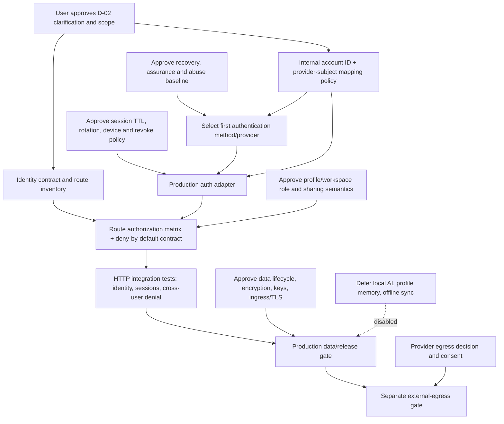

# VOKKI Identity ADR — Approval Review

| Field | Value |
|---|---|
| Status | Historical review sheet; superseded by the final ADR for the 15 approved requirements; not implementation authorization |
| Date | 2026-11-11 |
| Reviewed document | [VOKKI-IDENTITY-TENANCY-ADR.md](./VOKKI-IDENTITY-TENANCY-ADR.md) |
| Authority | [VOKKI-IDENTITY-TENANCY-ADR.md](./VOKKI-IDENTITY-TENANCY-ADR.md) records the approved identity/tenancy requirements; [VOKKI-MASTER-PRD.md](./VOKKI-MASTER-PRD.md) remains authoritative for broader product directions |
| Scope | Historical extraction and decision questionnaire; superseded for the 15 identity/tenancy requirements by the final ADR |
| Restrictions observed | Documentation-only update; no implementation, schema/memory/conversation changes, provider integration, production login, or release approval |

> **Supersession notice (2026-11-12):** The user explicitly approved the 15 identity/tenancy requirements recorded as IT-01–IT-15 in the [final ADR](./VOKKI-IDENTITY-TENANCY-ADR.md). This historical questionnaire's blank response fields and “proposed” labels are not the current decision record. The final ADR's deferred-choice and production-gate sections remain authoritative for what is still unresolved. No provider or production implementation was approved.

## 1. Executive outcome

The Master PRD records approved **product directions**, not completed implementation choices or release approval. D-02 now records one PARMAR-wide account/SSO boundary, optional future login-method linking, personal/multiple-profile/family-team eventual scope, and strict isolation. It does not select an authentication provider or settle detailed account-linking, recovery, family/team permissions, workspace policy, or rollout gates.

The final ADR records the approved requirements for internal immutable account IDs, provider-neutral PARMAR-wide identity, per-device sessions, owner-controlled profiles with explicit grants, user-scoped memory, and scoped external-provider consent. The provider, technical designs, detailed policy, and release evidence remain open as identified in that record. No provider or authentication method is selected.

**Production authentication remains blocked.** A design/route contract and test plan can be completed without choosing a provider, but implementation of a production sign-in path requires approval of the first authentication method and account mapping, recovery/assurance baseline, session policy, and protected-route authorization boundary.

## 2. Approved product directions versus unresolved policies

### Approved product directions recorded in Master PRD §11

These are not reopened by this review. Their exact wording is in the authoritative PRD decision register.

| Decision | Approved direction | What remains unapproved / unproven |
|---|---|---|
| D-01 | Web-first; Desktop, Android, and iOS are future independently gated platforms. | Native session/storage implementation, platform schedules, sync behavior, and each release's evidence. |
| D-02 | One PARMAR-wide account/SSO boundary; optional future login linking with fresh proof; personal, multiple-profile, family/team modes as approved eventual scope, with strict isolation. | Provider/method selection; account mapping; linking/recovery implementation; detailed family/team policies, permissions, invitations, and release gates. |
| D-03 | Hybrid local/external AI, task-appropriate routing, explicit consent before external transfer, no silent fallback. | Provider/model/runtime selection, consent granularity and UX, retention terms, provider regions, routing, and egress evidence. |
| D-04 | Automatic memory with user review/edit/delete/export/reset controls. | Memory scope, capture/retention details, consent versioning, deletion timelines, backup/replica treatment, and implementation evidence. Existing memory remains user-scoped. |
| D-05 | Camera understanding only with explicit permission and user-initiated capture; no hidden/background recording. | Per-platform storage/cleanup, processing, and lifecycle acceptance. |
| D-06 | Multilingual voice direction, initial push-to-talk; wake-word/background listening needs separate approval/security gates. | Locale/platform support, processing locality, transcript retention, and any later wake-word approval. |
| D-07 | Preserve high-quality 3D, photorealistic-premium, and cinematic directions; renderer selection remains open. | Renderer, assets, license, platform/device support, and quality claims. |
| D-08 | Guide/Execute/Orchestrate under PARMAR Core governance, authorization, approval, and verification. | Action categories, executor, independent evidence, and operational gates. Identity must not imply execution authority. |
| D-09 | Hybrid online/offline vision, local AI where supported, offline drafts and controlled sync; never automatically replay queued side-effecting actions. | Offline data classes, keys, conflict policy, cache retention, sync protocol, and runtime verification. |
| D-10 | WCAG 2.2 AA target, multilingual support, and measurable platform-specific quality standards. | Locale/platform matrix and conformance evidence. |
| D-11 | Research with source links/evidence, conflict disclosure, uncertainty, and independent verification. | Evaluator criteria and verified-claim thresholds. |
| D-12 | PARMAR-managed independent local-AI infrastructure plus evaluated external models; no runtime/model/vendor selected. | Runtime/model, hardware support, update owner, licenses, and supply-chain evaluation. |
| D-13 | User-controlled VOKKI environment/appearance customization preserving canonical identity, voice, and personality; uploaded assets require rights/safety/consent checks. | Technical implementation and platform-specific asset/lifecycle gates. |

**Evidence:** [VOKKI-MASTER-PRD.md §11](./VOKKI-MASTER-PRD.md#L1065) records D-01–D-13 and their safe-behavior gates. The PRD's top-level decision-status note says this is documentation traceability, not implementation, technical/vendor selection, production acceptance, or release approval.

### Verified current implementation (not production acceptance)

- [identity.py](./identity.py#L17) defines the server-established principal contract and anonymous Local Demo resolver; no production credential verifier is established by this contract.
- [identity_store.py](./identity_store.py) creates profile/workspace/membership/profile-association tables and, under the separately authorized Task 37, an internal account-registry foundation. The registry is not connected to authentication or legacy owner IDs; invitation flow and complete multi-user authorization remain absent.
- [futuristic_app.py](./interface/futuristic_app.py#L91) constrains the optional development login to an explicit development configuration; it is not production identity. Profile selection checks ownership at [futuristic_app.py](./interface/futuristic_app.py#L1069).
- [sessions.py](./sessions.py#L230) contains the server-side session store; session rotation/revocation exist, but the reviewed HTTP surface has no user-facing production authentication or device-management flow.
- [conversations.py](./conversations.py#L746) adds nullable profile association without assigning legacy records. This review does not authorize reassignment.
- [memories.py](./memories.py#L265) stores consent and memory by user ID, not profile/workspace. No scope change is proposed.
- The [Part 13 governance report](./VOKKI-PART13-PRIVACY-SECURITY-GOVERNANCE-REPORT.md#L28) records production identity, data lifecycle, encryption, and provider-consent gaps. Source inspection does not establish deployed runtime behavior.

## 3. Resolved D-02 wording clarification

### The inconsistency

- **Historical wording in PRD §3.1:** “Support one personal profile initially; family/team profiles, shared workspaces, profile switching, and owner/admin/member roles require explicit product approval.” The PRD wording has since been reconciled: those modes are approved eventual scope; their detailed policies and enablement remain separately gated.
- **Approved D-02 in PRD §11** includes “personal, multiple-profile, family/team modes with strict isolation.”
- The PRD's D-02 register approves eventual product scope while leaving technical and security decisions open.

### Approved clarification

The approved D-02 product direction includes personal, multiple-profile, and family/team modes as eventual product scope. PRD §3.1 requires separate approval of **detailed semantics, implementation, and release enablement**, not re-approval of that direction.

The following clarification is now recorded in the authoritative PRD and final ADR:

> “The approved D-02 product direction includes personal, multiple-profile, and family/team modes as eventual product scope. Initial implementation and release remain gated on explicit approval of workspace semantics, membership and role permissions, profile-sharing rules, and security acceptance. Until those gates pass, expose only the approved and verified scope.”

The D-02 clarification is recorded in the PRD and final ADR. It does not authorize family/team implementation, invitations, sharing, or cross-user access before their separate policy and security gates pass.

## 4. Numbered user approval sheet

For each item, choose **Approve recommendation**, **Change**, or **Defer**. “Approve” below records a proposed architecture policy only; it does not by itself authorize a provider integration, source change, migration, production launch, or release. A safe deferral keeps the dependent capability disabled.

### 1. Internal account identity and provider-neutral boundary

- **Recommended:** PARMAR issues an immutable random internal `user_id`; each authentication method maps a unique `(issuer, subject)` to it. Keep a server-only provider-neutral adapter; identity attributes and provider claims do not grant PARMAR resource permissions.
- **Alternatives:** use provider subject as the account key; use email/phone as key; create PARMAR IDs and mappings (recommended).
- **Security/privacy:** internal IDs reduce provider coupling and avoid email-based reassignment, but the method-to-account mapping is sensitive and requires unique constraints, least privilege, audit, and recovery.
- **Dependencies:** approved account creation/closure semantics, account mapping design, data-owner mapping, test fixtures, and migration/rollback plan.
- **Blocks:** an implementation-ready identity contract and any production account mapping/sign-in; does **not** block a provider-neutral conceptual contract.
- **Safe to defer?** Provider-independent interface design can proceed; production accounts and login must remain disabled.
- **Your decision:** `____________________`

### 2. Initial authentication method, provider, and enrollment

- **Recommended:** do not select a provider in this review. First approve requirements and compare candidates; implement only one explicitly approved method through the server-side adapter. Treat email authentication as an unresolved design, not an assumed feature.
- **Alternatives:** PARMAR-managed credential; one hosted identity provider; multiple federated providers; hybrid; postpone production login.
- **Security/privacy:** managed credentials add credential storage, reset, and breach-response duties. Federation adds provider dependency and claim-validation requirements. Multiple methods increase account-linking and recovery complexity. Any method must use TLS, verified server-side proof, replay protection, anti-enumeration, and abuse controls.
- **Dependencies:** deployment/region, privacy/legal/vendor review, supported method enrollment, assurance and recovery decision, test tenant, callback/TLS inventory, operations owner.
- **Blocks:** production sign-in. Does **not** block completing policy/route contracts or isolated non-production tests with a purpose-built test adapter.
- **Safe to defer?** Yes; this is the safest deferral. No production authentication or external provider is enabled.
- **Your decision:** `____________________`

### 3. Optional Google, Apple, and email methods; linking and duplicate accounts

- **Recommended:** offer optional methods only if separately approved. Link after recent reauthentication to the current account and fresh proof of control of the new method. Never auto-link or merge from matching email/name. Do not remove the last usable method without a verified replacement/recovery path.
- **Alternatives:** no linking; link by verified matching email; dual proof; support-mediated merge.
- **Security/privacy:** matching email can be recycled, shared, or provider-verified under differing rules; unsafe linking can transfer all account data. Dual proof lowers takeover risk but adds friction. Support merge adds insider/error risk and requires audit.
- **Dependencies:** internal account mapping (#1), approved methods (#2), recovery (#4), account merge/closure policy, notifications, generic conflict UX, staged reversible migration.
- **Blocks:** method linking, account merge, data claim/portability; not a single-method login pilot with linking disabled.
- **Safe to defer?** Yes. Keep only the approved initial method, with no linking/merging and no automatic data claim.
- **Your decision:** `____________________`

### 4. Recovery, MFA/passkeys, assurance, and account abuse controls

- **Recommended:** approve a threat model and assurance floor before production. Evaluate passkeys and provider-managed MFA/recovery plus a robust fallback; require rate limits, single-use expiring recovery, replay resistance, non-enumerating responses, security notifications, session revocation, and step-up for sensitive actions. Do not set an exact mandatory MFA method here.
- **Alternatives:** provider-managed recovery; PARMAR-managed recovery; passkeys/security keys/TOTP; combinations; no recovery (not production-safe).
- **Security/privacy:** provider recovery imports that provider's account-security and availability risks. PARMAR recovery increases abuse/support and data exposure. Email-only recovery is vulnerable to mailbox compromise. Support overrides need strict audit and least privilege.
- **Dependencies:** method/provider decision (#2), support ownership, accessibility, abuse monitoring, session revocation (#5), recovery and incident exercises.
- **Blocks:** production account recovery and sensitive account changes. A pilot may not be exposed to real users without an explicitly approved recovery/assurance baseline.
- **Safe to defer?** Detailed UX/channel can be deferred during design; production account creation cannot be released without a reviewed recovery posture.
- **Your decision:** `____________________`

### 5. Session, device inventory, revocation, and step-up

- **Recommended:** PARMAR-owned per-device revocable server sessions; web uses secure cookies and CSRF, native clients use OS-protected storage for opaque credentials. Define session lifetime, remote revocation, concurrent-device policy, device metadata, rotation, and step-up before release.
- **Alternatives:** stateless long-lived tokens; access/refresh tokens; opaque server-side sessions (recommended continuation of current prototype).
- **Security/privacy:** centralized opaque sessions support revocation but require a durable, available session store. Stateless tokens complicate immediate revocation. Device lists/metadata may be sensitive; collect the minimum needed. Lost offline devices cannot be immediately erased.
- **Dependencies:** auth method (#2), recovery (#4), production deployment/session store and key management, platform secure-storage review, UX and revocation tests.
- **Blocks:** production session issuance and device management; exact device UI may be staged, but session TTL/revocation semantics cannot.
- **Safe to defer?** Detailed device-history display and concurrency limits may be deferred. Expiry, rotation, logout, and account/security revocation are not deferrable for production.
- **Your decision:** `____________________`

### 6. D-02 clarification: family/team product direction versus §3.1 gate

- **Recommended:** accept the interpretation in §3: D-02 approves eventual family/team and multiple-profile product scope; detailed policies and implementation/release still require separate approval.
- **Alternatives:** treat D-02 as superseding §3.1 entirely; treat §3.1 as narrowing current approved scope to one personal profile until a later explicit product decision; reconcile the PRD in another way.
- **Security/privacy:** prematurely enabling shared workspaces risks cross-user disclosure; treating the D-02 direction as revoked would silently alter an approved product decision.
- **Dependencies:** explicit interpretation, then decisions #7–8 on workspace roles and profile grants. No authoritative text is changed here.
- **Blocks:** multi-profile/family/team implementation and release until clarified; does not block a minimal personal-account identity contract.
- **Safe to defer?** Yes for multi-user implementation; the ADR can record the proposed interpretation but must not present it as accepted.
- **Your decision:** `____________________`

### 7. Workspace types, membership, invitations, roles, and family rules

- **Recommended:** model account, profile, and workspace as separate identities; workspace membership conveys administration/use only, not profile-content access. Use OWNER/ADMIN/MEMBER only after defining precise capabilities. Invitations are expiring, single-use, workspace/role-bound and accepted by an authenticated account. Keep owner/admin authority distinct from content access.
- **Alternatives:** single-user workspaces; personal profiles only; workspace-owned profiles; account-owned profiles shared by explicit grants (recommended); broader role-based inherited access.
- **Security/privacy:** workspace-owned data simplifies collaboration but blurs personal ownership. Inherited role access can leak sensitive family/team content. Family/guardian/dependent features may carry additional legal and safeguarding requirements.
- **Dependencies:** D-02 clarification (#6), family/team requirements, invitation/transfer policy, data scope, authorization route matrix and cross-tenant tests.
- **Blocks:** invitations and multi-user workspace access. Basic personal accounts/profiles can be built with no workspace sharing.
- **Safe to defer?** Yes; keep workspaces single-owner/non-sharing and sharing endpoints disabled until approved.
- **Your decision:** `____________________`

### 8. Profile sharing, admin visibility, grants, revocation, and ownership

- **Recommended:** profiles remain owned by one account; sharing requires both active workspace membership and explicit, revocable profile/resource grant. Owner consent controls the grant; workspace admins cannot grant another owner's profile or elevate themselves. Define view/edit/invite/export/delete separately.
- **Alternatives:** membership grants all workspace profiles; workspace admins inherit access; per-profile grants; per-resource grants (fine-grained, higher complexity).
- **Security/privacy:** default inheritance is easy to use but creates broad disclosure and stale-access risk. Explicit grants minimize access but need clear UX, cache invalidation, immediate revocation and race handling.
- **Dependencies:** #6–7, resource ownership model, every route's authorization predicate, stale-response/cache/sync handling, audit.
- **Blocks:** profile sharing, cross-user access, shared conversations/files/memory. Does not block owner-only personal profile use.
- **Safe to defer?** Yes; deny sharing and expose no shared-content route until policy and tests are complete.
- **Your decision:** `____________________`

### 9. Memory scope

- **Recommended:** preserve current user-scoped memory and current ownership. Do not migrate or change its scope. Treat any future profile-scoped memory as a separate feature and data class requiring explicit consent, policy, and migration decision. Do not enable workspace-shared memory by default.
- **Alternatives:** user-only permanently; user-only now with later separate profile scope; profile-only; both; workspace-shared.
- **Security/privacy:** user scope preserves continuity but may carry preferences across profiles; profile scope isolates contexts but changes current behavior and increases migration/cache complexity; workspace scope adds substantial sharing/consent risk.
- **Dependencies:** #10 lifecycle/consent; if scope ever changes, separately approved design, data migration, profile-switch handling, and cross-scope tests.
- **Blocks:** only a new memory scope. It does **not** block identity milestone work because existing behavior remains user-scoped.
- **Safe to defer?** Yes. Keep existing user scope; no migration and no new memory-sharing feature.
- **Your decision:** `____________________`

### 10. Consent, retention, review/export/delete/reset, account closure

- **Recommended:** define per-data-class purpose/consent, revocation, review/edit/export/delete/reset, retention, backup/replica expiry, provider-copy limitations, and closure outcomes. Treat revocation as blocking future use, not proof of deletion. Report pending/retained/unrecallable data honestly.
- **Alternatives:** immediate delete; staged closure with grace period; retention exceptions under documented/legal basis; retain until user deletion (current memory behavior, not a complete lifecycle policy).
- **Security/privacy:** longer retention increases exposure; immediate deletion may conflict with recovery, legal/security records, backups or in-flight tasks. Provider egress may not be recallable. Proposed numeric deletion windows in PRD R-03 are explicitly unapproved.
- **Dependencies:** data inventory, #9 memory scope, encryption/backup (#11), provider terms (#12), legal/privacy/operations ownership and deletion tests.
- **Blocks:** production memory/data lifecycle and account closure. It need not block an isolated identity-contract milestone that stores no production user data.
- **Safe to defer?** Exact retention timelines can be deferred only while the affected persistent feature remains disabled or explicitly non-production; not safe to imply deletion/retention promises.
- **Your decision:** `____________________`

### 11. At-rest encryption, backups, keys, residency, and recovery objectives

- **Recommended:** require encryption for production user data and backups, with deployment-appropriate envelope/key management, least privilege, rotation/revocation, documented residency, restore and recovery exercises. Do not treat file permissions or session integrity tags as content encryption.
- **Alternatives:** filesystem encryption only; database/application encryption; managed envelope encryption; platform-protected local keys; layered combination.
- **Security/privacy:** filesystem-only may not protect copied files or application access; database encryption adds key/runtime dependencies; managed key services improve control/audit but introduce service availability and vendor trust; local keys complicate recovery and sync.
- **Dependencies:** deployment topology, data classification, KMS/OS key support, backup design, key owner, RPO/RTO, threat review and restore testing.
- **Blocks:** production persistence of sensitive identity, memory, conversation, or workspace data. It does not block a schema/API design document or isolated synthetic test data.
- **Safe to defer?** Provider/technology selection can be deferred; production data persistence cannot be declared ready without an approved effective control.
- **Your decision:** `____________________`

### 12. External AI providers, consent cadence, egress and fallback

- **Recommended:** honor D-03: require explicit user consent before external transfer, scoped to provider, purpose, and data category; minimize context; enforce policy and TLS; no silent fallback. Keep OpenAI, Claude, Gemini, and any other external provider unselected until individual review.
- **Alternatives:** local-only; server-configured external provider; per-user consent (recommended); user-selected provider/request.
- **Security/privacy:** server configuration is not user consent. Per-request consent gives user control but adds state/UX complexity. Provider terms/region/retention and deletion limits affect disclosure. Consent to sign in with a company does not consent to its AI product.
- **Dependencies:** identity (#1–5), profile/workspace authorization (#7–8), provider evaluation/terms, consent UX, data minimization, audit, zero-egress tests.
- **Blocks:** external provider egress. It does not block local/demo behavior that does not transmit user data externally.
- **Safe to defer?** Yes, indefinitely; external egress remains disabled absent all gates.
- **Your decision:** `____________________`

### 13. Local AI runtime/model and update ownership

- **Recommended:** make no runtime/model/vendor choice until a reproducible POC, license/supply-chain review, device matrix, data-locality/telemetry evidence, and named patch/update owner are available.
- **Alternatives:** no local inference; PARMAR-managed runtime; device/OS runtime; selected third-party local runtime/model.
- **Security/privacy:** local execution can reduce external transfer but is not automatically offline or private; telemetry, model/runtime supply chain, local caches, updates, and hardware support remain risks.
- **Dependencies:** D-12 evaluation, hardware/platform scope, update/rollback owner, cost/quality testing, security review.
- **Blocks:** local-AI claims and deployment, not account/session architecture or an identity milestone.
- **Safe to defer?** Yes. Keep inference capability unclaimed/disabled until evaluated.
- **Your decision:** `____________________`

### 14. Offline data classes, synchronization, conflicts, and disconnected devices

- **Recommended:** uphold D-09 but defer implementation choices. Start online-first; allow only approved encrypted drafts/cache; reauthorize server-side on sync; handle revocation and conflict explicitly; never auto-replay side-effecting actions.
- **Alternatives:** online-only; isolated per-device local data; encrypted controlled sync; broad/full cache.
- **Security/privacy:** offline copies cannot be immediately revoked while disconnected; broad caches increase device-loss exposure; sync has conflict, key recovery, stale grant, deletion, and duplicate-action risks.
- **Dependencies:** D-01 platform gates, #5 session revocation, #7–8 authorization, #10 lifecycle, #11 keys, platform secure-storage and sync protocol tests.
- **Blocks:** cross-device/offline persistence and sync; not web-first online identity.
- **Safe to defer?** Yes; safest deferred item. Do not claim sync/offline identity or replay queued work.
- **Your decision:** `____________________`

### 15. Account closure, support/break-glass access, and operational ownership

- **Recommended:** design authenticated, step-up-confirmed closure that revokes sessions/approvals and reports per-data-class deletion/retention status. Provide no standing support content access; any approved break-glass must be time-bound, purpose-limited, independently audited, and least-privileged.
- **Alternatives:** immediate closure; grace-period closure; documented retention exceptions; no support access; audited emergency access.
- **Security/privacy:** a grace period improves recovery but prolongs retention; immediate deletion may be infeasible for backups or required records. Break-glass improves incident handling but is an insider threat. Do not promise provider deletion without evidence.
- **Dependencies:** #4 recovery, #5 revocation, #10 lifecycle, #11 backup/key design, named support/security/legal owners.
- **Blocks:** production account closure and support operations; not a synthetic, non-production contract milestone.
- **Safe to defer?** Support tooling can be deferred with no support access. Production account closure cannot be advertised without a reviewed policy and truthful behavior.
- **Your decision:** `____________________`

### D-02 clarification choice

Choose one interpretation; this is a clarification of the existing approved direction, not a request to silently edit the PRD:

1. **Approve proposed clarification:** D-02 approves eventual product scope; detailed semantics and enablement remain separately gated.
2. **Change:** provide alternative interpretation.
3. **Defer:** keep family/team and multiple-profile implementation disabled pending direct reconciliation.

**Your decision:** `____________________`

## 5. Decisions that can safely remain deferred

Deferral means the dependent capability stays disabled or unclaimed; it does not grant a permissive default.

| Decision safely deferrable | Safe interim behavior | What cannot proceed |
|---|---|---|
| Production provider/vendor, exact protocol and region | Keep production login disabled; define only a provider-neutral contract. | Production login/account creation. |
| Google/Apple/email availability and method linking | No external login methods, linking, auto-merge, or development-data claim. | Optional linked methods and account portability. |
| Exact MFA/passkey/recovery channel | Continue architecture/design only; do not expose production accounts without an approved recovery/assurance baseline. | Production account recovery and security-sensitive account changes. |
| Family/team detailed roles, invitation UX, guardian rules | Single-account owner-only behavior; no invitations or shared content. | Multi-user workspace access/sharing. |
| Profile- or workspace-scoped memory | Keep existing user-scoped memory unchanged; do not migrate. | Any new memory scope. |
| Memory and account deletion timelines | Make no unsupported deletion promise; keep affected persistent feature non-production until policy is approved. | Production lifecycle claims and closure completion. |
| External AI provider, consent cadence, data categories | No external egress. | Provider-enabled release. |
| Local AI runtime/model | No local AI availability/privacy claim. | Local inference deployment/claim. |
| Offline synchronization and cache policy | Online-first; no sync or queued action replay. | Offline/sync release. |
| Break-glass/support access | No routine or support content access; incident access, if unavoidable, requires separate emergency governance. | Support-assisted account/data operations. |

**Not safely deferrable for production sign-in:** immutable internal account mapping; selected initial authentication method/provider; server-side validation and account status; recovery/assurance baseline; session expiry/revocation semantics; protected-route authorization; production ingress/TLS; cross-user denial tests. A small non-production design/test milestone can proceed without these final provider choices, but must use synthetic fixtures and cannot issue production identities.

## 6. Implementation dependency map — next identity milestone

### Milestone goal

Deliver an implementation-ready, provider-neutral **Identity Contract and Route Authorization Matrix** first. Then, only after approval gates are met, implement one approved production authentication method. This milestone does not authorize production login or data migration.

### Ordered dependencies and gates

| Order | Work product / gate | Prerequisites | Exit evidence | Can proceed if unresolved? |
|---|---|---|---|---|
| 0 | Approval record: D-02 clarification and initial personal-account scope | User response to approval sheet | Explicit decision; no inferred permission | Contract drafting can proceed with conflict noted; shared-workspace implementation cannot. |
| 1 | Identity/account contract | Approve internal ID and issuer/subject mapping (#1); provider-neutral boundary | Account lifecycle, method mapping, status, errors, assurance fields, no client identity authority | Conceptual draft can proceed; schema/implementation waits. |
| 2 | Route and data authorization matrix | Current route/data inventory; account contract; D-02 scope; workspace decisions (#7–8) or explicitly excluded scope | Every protected route, method, data class, owner/scope predicate, denial status, public exception and test case enumerated | Personal-only matrix can proceed with all sharing denied; production exposure waits for complete route coverage. |
| 3 | First authentication method decision | #1, privacy/legal/security/vendor review, method choice (#2), link policy (#3) if linking is included | Approved method, deployment boundary, callback/TLS, test tenant, no account enumeration | No production auth implementation without this; no-link single-method pilot may exclude #3. |
| 4 | Recovery, assurance, and abuse policy | Chosen method (#3), support owner (#4) | Threat-reviewed recovery/MFA/passkey, rate limit, step-up, notification, revocation requirements and tests | Production account issuance is blocked. |
| 5 | Session/device contract | Method and recovery policy (#3–4), deployment/session-store plan | TTL, rotation, cookie/native credential, per-device revocation, logout and account-wide revoke acceptance | Design can proceed; production sessions are blocked until semantics and ops availability are approved. |
| 6 | Production ingress and sensitive-data baseline | Deployment topology; TLS/proxy, encryption/key, backup and lifecycle policies (#10–11) | Verified TLS/proxy path, key ownership/rotation, restore, data retention and failure behavior | Synthetic integration tests can proceed; production user data persistence/release is blocked. |
| 7 | Implementation of approved first auth path | Orders 0–6 for target scope; approved PRD requirements | Real HTTP tests for callback/auth, account resolution, sessions, recovery/revocation, invalid identities, abuse and denial | No implementation until gates pass. Task 30.1 itself authorizes documentation only. |
| 8 | Workspace/sharing capability | D-02 clarification, family/team and role decisions (#6–8) | Invitations, role/grant checks, revocation, two-user/two-workspace allow/deny matrix | Safely deferred; endpoints/features stay disabled. |
| 9 | Provider egress / local AI / offline sync | Egress consent (#12), runtime selection (#13), sync choices (#14), and independent PRD gates | Zero-egress denials, consent, runtime/egress evidence, revocation/conflict/delete tests | Safely deferred; no external egress, local-AI claim, or sync. |

### Minimum identity-milestone acceptance

- Every protected route in the approved inventory derives the principal from trusted server-side credentials; client IDs/roles cannot alter it.
- Internal user ID is immutable and independent of email/provider changes; unknown/duplicate issuer-subject mappings fail closed.
- The selected initial method is validated server-side; invalid, replayed, expired, wrong-audience, wrong-issuer, or disabled-account assertions are denied.
- Session issuance, expiry, rotation, logout, revocation, account disablement, and pending-approval invalidation pass real HTTP tests.
- Origin/CSRF policy is explicit and tested across cookie-authenticated unsafe methods.
- Cross-user and cross-profile denial tests cover reads and writes. With sharing unapproved, all cross-user workspace/profile content access is denied.
- Existing development identity remains explicitly unverified and is never silently upgraded or automatically mapped to a production account.
- Existing conversation owners and nullable profiles remain unchanged; no automatic legacy assignment.
- Existing memory remains user-scoped; no ownership migration or inferred consent.
- No production readiness claim until target deployment ingress, TLS/proxy, sensitive-data encryption, key lifecycle, backup/restore, and operational gates are verified.

## 7. Recommended next task

**Task 31 — Finalize the VOKKI identity and tenancy decision record and traceability.**

The Task 31 documentation deliverables are the [final ADR](./VOKKI-IDENTITY-TENANCY-ADR.md), the [traceability matrix](./VOKKI-IDENTITY-TENANCY-TRACEABILITY.md), and the reconciled PRD wording. They do not authorize an authentication implementation. A later production identity milestone must first satisfy the provider-comparison/security-approval, account mapping, recovery/assurance, session/device, route inventory, ingress/TLS, data-protection, and synthetic-data acceptance gates.

## 8. Evidence and limits

### Repository and decision evidence

- [VOKKI-IDENTITY-TENANCY-ADR.md](./VOKKI-IDENTITY-TENANCY-ADR.md) — final decision record for approved identity/tenancy requirements, deferred technical choices, and production gates.
- [VOKKI-IDENTITY-TENANCY-TRACEABILITY.md](./VOKKI-IDENTITY-TENANCY-TRACEABILITY.md) — requirement-to-PRD/current-evidence/gap/future-task matrix.
- [VOKKI-MASTER-PRD.md](./VOKKI-MASTER-PRD.md#31-identity-onboarding-accounts-and-profiles) — PARMAR-wide identity/SSO requirements and clarified D-02 scope.
- [VOKKI-MASTER-PRD.md §11](./VOKKI-MASTER-PRD.md#L1065) — approved D-01–D-13 directions and safe-behavior/dependency gates.
- [identity.py](./identity.py#L17) — server principal contract and anonymous Local Demo resolver.
- [identity_store.py](./identity_store.py#L48) — profile/workspace store; schema version and existing owner/member/grant structure.
- [interface/futuristic_app.py](./interface/futuristic_app.py#L91) — development auth guards; [profile selection](./interface/futuristic_app.py#L1069) enforces owner check.
- [sessions.py](./sessions.py#L230) — session store; lifecycle methods and current cookie/CSRF controls.
- [conversations.py](./conversations.py#L463) — versioned conversation repository and nullable profile migration.
- [memories.py](./memories.py#L265) — user-scoped memory and consent persistence.
- [README.md](./README.md#L230) — current session, development-auth, conversation, and memory disclosures.
- [VOKKI-PART13-PRIVACY-SECURITY-GOVERNANCE-REPORT.md](./VOKKI-PART13-PRIVACY-SECURITY-GOVERNANCE-REPORT.md#L28) — current security gaps and evidence limits.

### Limitations

- This review reads source and documentation; no test suite, build, deployed environment, provider, or device was exercised.
- No listed recommendation is an approval, security certification, production-readiness claim, or authorization to change authoritative documents.
- No application source, schema, migration, memory/conversation scope, provider integration, or production login was changed.
- AETHER remains outside the VOKKI identity boundary.
