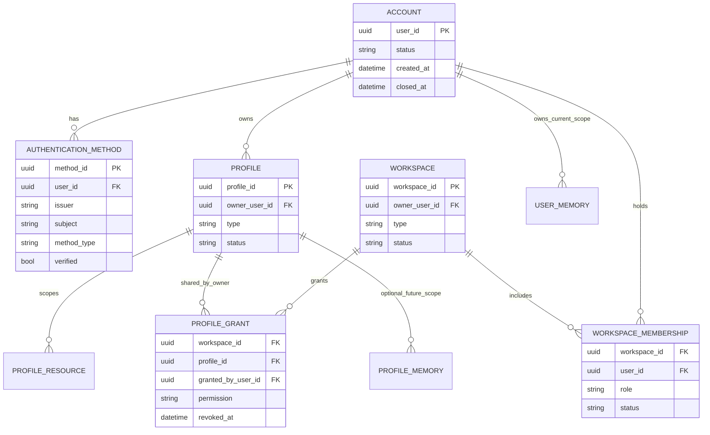
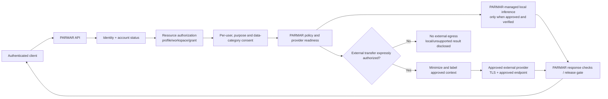

# VOKKI Identity, Tenancy, and Data Isolation

## Architecture Decision Record — Draft for Review

| Field | Value |
|---|---|
| Status | **Draft — not approved; no implementation authorization** |
| Date | 2026-11-11 |
| Scope | VOKKI identity, authentication, sessions, profiles, workspaces, data isolation, memory, provider egress, and cross-platform access |
| Authority | PARMAR Core remains the policy, authorization, approval, execution, verification, and audit authority |
| Related product requirements | VOKKI Master PRD D-01–D-04 and D-09; identity acceptance criteria ID-01–ID-04 |
| Explicit exclusions | No provider selection/integration; no schema or source changes; no memory/conversation ownership change; no automatic legacy-conversation assignment |

> **Decision-state rule:** The product directions marked **Approved product direction** below are already recorded in the VOKKI Master PRD. This ADR does not approve their technical realization. All recommendations marked **Proposed** require the listed approval before implementation. This draft supplements, and does not replace or amend, the Master PRD, its decision register, or the privacy/security report.

## 1. Executive summary

VOKKI requires PARMAR-controlled accounts and strict separation among account identity, personal profiles, workspaces, and resources. The current implementation is a prototype foundation: it has a server-established principal contract, a development-only unverified login, opaque server-side sessions, personal profile ownership checks, a nascent workspace directory, owner-filtered conversations, and explicitly consented user-scoped memory. It does not provide production identity proof, real account recovery, a complete multi-user workspace authorization model, production account lifecycle, or encrypted-at-rest data and backup/key management.

The recommended direction is to keep an immutable PARMAR internal user ID as the canonical account key, and treat any approved authentication method as a replaceable, provider-neutral proof-of-control adapter. Profiles remain distinct from accounts and workspaces. Workspace membership alone must not grant access to profile content: access requires a current, explicit resource/profile grant plus the relevant workspace permission. All access checks are server-side and deny by default.

Keep the existing memory boundary **user-scoped**. Do not migrate memory to profile/workspace scope in this ADR or implementation. Any future profile-scoped memory is a separately approved data class with separate consent and migration. External AI transfer is gated per user, purpose, provider, and data category; PARMAR must not silently fall back to external inference. Offline synchronization follows the approved D-09 direction but remains disabled until conflict, encryption, revocation, and deletion behavior are specified and tested.

**No production-readiness claim follows from this design.** Provider, recovery/MFA, tenancy details, memory scope beyond the current user-scoped behavior, encryption/key custody, data retention, and synchronization policy need explicit decisions and acceptance evidence.

## 2. Status and evidence labels

- **Approved product direction** means the Master PRD records the user's product decision. It does not establish implementation or security acceptance.
- **Verified current fact** means supported by the source/document cited here. No tests were run for this ADR.
- **Proposed architecture** is a recommendation, not an approved policy or implementation specification.
- **Approval required** identifies a product, security, privacy, legal, or operations decision that must be resolved before the dependent capability is implemented or released.
- **Not verified** means this read-only source review cannot establish runtime, deployment, provider, device, backup, or production behavior.

The current Master PRD is itself a draft and explicitly distinguishes approved product directions from unresolved technical/vendor choices and release acceptance. See [VOKKI-MASTER-PRD.md](./VOKKI-MASTER-PRD.md), especially its decision-status note, §3.1, §3.13, §3.16, and §11.

**Source-document discrepancy to resolve:** PRD §3.1 says family/team profiles and shared workspaces require explicit product approval, while its approved D-02 register in §11 includes personal, multiple-profile, family/team modes. This ADR treats D-02 as the recorded approved product direction, but does not infer detailed family/team permissions from it. Product should reconcile the wording before implementation.

## 3. Current architecture reference

### Verified current facts

1. **Identity contract:** [`identity.py`](./identity.py) defines a server-created `Principal` containing authentication state, user UUID, and authentication source. `LocalDemoPrincipalResolver` always returns anonymous Local Demo. The contract says client input does not establish identity and identity is separate from permissions and PARMAR safety.
2. **Development authentication:** [`interface/futuristic_app.py`](./interface/futuristic_app.py) has a fixed development UUID and `local-development-unverified` source. The optional bridge is disabled unless explicitly enabled, requires development environment, IPv4 loopback, configured HTTPS/TLS, and exact origin. The README says this is not identity verification or production authentication. It is not a production login method.
3. **Sessions:** [`sessions.py`](./sessions.py) persists opaque sessions in SQLite, stores a token hash and keyed integrity tag rather than the plaintext cookie token, enforces idle and absolute expiry, supports rotation and revocation, and clears active-profile context on expiry/revocation/rotation. Cookies are Secure, HttpOnly, SameSite=Lax, and `__Host-` scoped. Authenticated unsafe requests require CSRF.
4. **Profiles and workspaces:** [`identity_store.py`](./identity_store.py) currently has profiles, workspaces, workspace members, and workspace-profile associations. Profiles have an `owner_user_id`; membership roles are OWNER, ADMIN, and MEMBER. The store is schema version 1 and has no account/user table or production credential/authentication implementation. The HTTP profile-selection route checks profile ownership against the authenticated session user.
5. **Current workspace limitation:** Workspace creation gives the creator OWNER membership. Adding a profile to a workspace requires that the caller own the profile and be an OWNER or ADMIN member. Workspace members can list associated profiles. Product documentation states invitations, cross-user sharing, and workspace-level conversation/memory scoping are not implemented.
6. **Conversations:** [`conversations.py`](./conversations.py) uses an owner user ID and nullable profile ID. The migration to schema version 3 adds `profile_id` without assigning existing rows. HTTP conversation operations require an active profile and include authenticated owner/profile filters. No automatic legacy reassignment is proposed here.
7. **Memory:** [`memories.py`](./memories.py) stores records and consent by owner user ID, requires explicit consent for save/retrieval, and filters queries by the owner. It is not profile/workspace scoped. [`interface/static/index.html`](./interface/static/index.html) and the README explicitly say this SQLite memory is not encrypted at rest; records remain until deleted/cleared, subject to current limits.
8. **Current security/operations gaps:** The privacy/security report identifies production identity/authorization, data lifecycle, encryption/key management, backups, and provider egress consent as unresolved or partial. Source inspection is not evidence that these protections operate in a deployed service.

### Relationship model — proposed



The diagram is conceptual, not a schema proposal ready to execute. The Account, Profile, and Workspace IDs are separate namespaces. A workspace does not own or merge its members' account identities. A profile remains owned by one account; its presence in a workspace is an explicit, revocable grant. Current user-scoped memory is shown separately from a possible future profile-memory class; the latter is disabled pending approval.

## 4. Proposed architecture

### 4.1 Identity invariants

- PARMAR issues an immutable, random internal `user_id` when an account is created. It is the canonical owner key for PARMAR data and is never derived from email, phone number, provider subject, display name, or client storage.
- Provider identity is a separate authentication-method record: `(issuer, subject)` is the stable external key, namespaced by issuer. Email/phone are attributes and proof-of-control channels, not account primary keys.
- Authentication proves control of an approved method; authorization is independently evaluated by PARMAR for every operation. A provider role, group, email domain, workspace claim, or client-provided ID does not itself grant PARMAR resource access.
- Authentication adapters return a verified identity assertion to a PARMAR-owned account-resolution service. Only that service can resolve or create an internal account and invoke session issuance.
- Development/local-demo identities cannot be interpreted as verified accounts, automatically upgraded, or used to claim existing user data.
- Account lifecycle state is checked before issuing or refreshing a session and at authorization boundaries. Suspended/closed accounts are denied; relevant sessions and pending approvals are revoked.

### 4.2 Profiles and tenancy

- **Account:** one independent person's or approved entity's PARMAR identity and authentication methods.
- **Personal profile:** a separately addressable context owned by an account. One account may own multiple profiles. A profile is not another account, credential, or security principal.
- **Workspace:** a collaboration boundary of type FAMILY or TEAM. It contains account memberships and explicit grants to profiles. It is not a credential and does not automatically own the member's content.
- **Membership:** a user's role and status in one workspace. Invitations must be single-use, time-limited, bound to intended workspace/role, and accepted only after authentication. Membership removal/revocation is effective for subsequent requests and invalidates affected cached grants.
- **Profile grant:** an explicit owner's consent to expose a profile in a particular workspace, with a stated permission set and revocation path. A membership alone does not grant profile access. A profile grant alone does not bypass workspace membership. Both must be active.
- **Resource authorization:** every read/write/export/delete checks authenticated account status, resource owner/scope, active profile or workspace context, membership and grant where applicable, operation permission, and current consent. IDs from URLs/payloads only select a candidate resource; they never establish authority.
- **Strict default:** deny on missing, stale, malformed, ambiguous, or unavailable authorization data. Do not fall back to owner-only, workspace-wide, local-demo, or cached access on an error.

### 4.3 Proposed workspace roles

| Role | Workspace administration | Profile visibility/content | Grant management |
|---|---|---|---|
| OWNER | Manage workspace, membership, invitations, and workspace settings; transfer/close workspace only under approved owner-transfer policy | No implicit access to profile content; only profiles explicitly granted to that person or a policy-approved workspace capability | May administer grants only within the profile owner's explicit authority; cannot grant a profile they do not own |
| ADMIN | Manage ordinary invitations and workspace settings as authorized | No implicit access to content; must also have explicit profile/resource grant | Cannot override profile owner consent or change the owner's grant |
| MEMBER | Use permitted workspace features | Access only explicitly shared profiles/resources and only for granted operations | Cannot invite/manage unless a separately approved permission is granted |

This is a proposal, not a settled family/team policy. Granular per-resource permission sets (for example view, edit, invite, export, delete) and any family guardian/dependent rules need product, privacy, and legal review. Workspace administrators must not be able to elevate their own content access merely by administering membership.

### 4.4 Authentication and session lifecycle

```mermaid
sequenceDiagram
    actor User
    participant Client as Web/Desktop/Mobile client
    participant Auth as Approved auth adapter
    participant PARMAR as PARMAR account resolver
    participant Session as PARMAR session service
    participant API as PARMAR API/authorization

    User->>Client: Sign in with an approved method
    Client->>Auth: Begin approved challenge/authorization
    Auth-->>Client: Auth response (no PARMAR authority claims)
    Client->>PARMAR: Submit response over authenticated TLS
    PARMAR->>Auth: Validate issuer, audience, signature, nonce, time and assurance
    Auth-->>PARMAR: Verified (issuer, subject, assurance)
    PARMAR->>PARMAR: Resolve unique internal user_id and account status
    PARMAR->>Session: Issue per-device server-side session
    Session-->>Client: Platform-appropriate session credential
    Client->>API: Request with session and requested resource ID
    API->>PARMAR: Resolve principal; evaluate owner, membership, grant, scope
    PARMAR-->>Client: Allow only authorized operation; otherwise deny
```

**Recommended lifecycle (proposed):**

1. Authentication challenges are generated server-side with state/nonce, bounded expiry, replay protection, and an approved redirect/callback allowlist. Validate issuer, audience, signature, nonce/state, expiry, and authentication assurance. Do not trust browser-decoded claims.
2. Resolve a verified method to exactly one internal account. Require explicit proof of control and recent reauthentication for linking/unlinking or other account-sensitive changes.
3. Issue a new per-device opaque server-side session only after account status and authentication policy pass. Do not reuse a pre-authentication session ID. Maintain idle and absolute expiry.
4. Rotate credentials at approved authentication/privilege boundaries and on refresh. Revoke the replaced credential atomically. Provide current-device and all-device revocation, with visible last-used/device metadata minimized to necessary fields.
5. Logout revokes server-side state and clears the client credential. Account suspension, account recovery, method unlink, security event, or closure can revoke selected/all sessions and pending approvals.
6. Require step-up authentication for linking/unlinking methods, recovery changes, export, account closure, workspace-owner transfer, and other approved high-impact operations.
7. Do not store provider access/refresh tokens in browser local/session storage. If a provider token is necessary server-side, encrypt it with a managed key, restrict scopes, rotate/revoke it, and disclose its purpose and retention.

**Platform session proposal:** Web uses the existing Secure, HttpOnly, SameSite cookie pattern with CSRF protection. Native desktop/Android/iOS clients use platform secure storage (OS keychain/keystore equivalent) for an opaque revocable credential; refresh/rotation remains server-controlled. Each device has a distinct server-side session and revocation handle. Clients share API/account contracts, not raw credentials or browser cookies across unrelated origins. Exact native flows and storage APIs require platform threat review and approval.

### 4.5 Optional Google, Apple, and email methods

No method or vendor is selected by this ADR. The product direction permits optional securely linked methods; actual availability, protocols, regions, assurance, costs, privacy terms, and recovery properties require approval.

- Google and Apple may be evaluated as external identity methods. PARMAR must validate the provider response server-side and store the provider's stable issuer/subject mapping, not treat a matching email as permission to merge accounts.
- “Email authentication” is ambiguous and must be approved as a distinct method (for example, passwordless one-time link/code, or a credential-backed method). Do not assume password storage is desired. If PARMAR stores passwords, a separate credential policy, modern password hashing, breach checking, reset controls, throttling, and operational review are prerequisites.
- Linking requires an authenticated current account, recent step-up proof for the existing method, and fresh proof of control of the new method. Linking conflicts must not disclose whether an unrelated account exists; return a generic resolution flow.
- Unlinking requires step-up authentication and confirmation that at least one approved, usable authentication/recovery method remains. Never permit unlinking the last means of account access.
- Duplicate accounts are not automatically merged based on matching email, name, or device. Use a user-initiated, strongly verified account-recovery/merge process, with a preview of affected data and reversible staged migration where feasible. Preserve provenance and audit.

## 5. Authorization matrix

This is a proposed minimum authorization model. It is not a production route matrix; every implemented route must be enumerated separately and mapped to an operation and scope.

| Actor/context | Account and own profile | Shared profile/resource | Workspace administration | Memory | Conversation |
|---|---|---|---|---|---|
| Anonymous / Local Demo | No authenticated account data | Deny | Deny | Existing browser-local demo remains separate; never import into account data | No authenticated history |
| Authenticated account owner | Own account operations with step-up for sensitive actions; own profiles | Only while explicit grant and membership are active | As workspace owner, within approved role policy | Current behavior remains user-scoped and consent-gated | Own records only, plus active-profile filter where the resource is profile-bound |
| Workspace OWNER | Own account/profile as above | No automatic access to another person's content | Workspace administration only | No implicit access or scope change | No implicit access |
| Workspace ADMIN | Own account/profile as above | Only explicitly granted operations | Delegated membership/invitation administration | No implicit access | No implicit access |
| Workspace MEMBER | Own account/profile as above | Only explicit profile/resource grant and permitted operation | No administration by default | No implicit access; future shared memory requires separate decision | No implicit access |
| PARMAR service/operator | No routine content access | No routine content access | No routine access | No routine access | No routine access |
| Audited support/break-glass operator (if approved) | Time-bound, purpose-limited access only with documented controls | Explicitly scoped, reviewed, and visible to affected user where safe | No standing privilege | No standing privilege | No standing privilege |

**Mandatory authorization predicate (proposed):** authenticated and active internal account AND valid session AND authorized operation AND resource is in the caller's ownership/scope AND, for shared resources, active workspace membership AND explicit active grant AND no relevant revocation/consent denial. Re-evaluate on every request; do not rely only on client state or a previously loaded profile.

## 6. Memory and privacy boundaries

### Current boundary to preserve

- Existing durable memory is **user-scoped**, consent-gated, and separate from profile/workspace identity.
- Existing memory is not encrypted at rest. Consent revocation stops retrieval/save/update under the current implementation but does not itself delete saved rows.
- This ADR does **not** migrate, reassign, or change the scope of any current memory.

### Future controls — proposed requirements

- Explain each memory scope and use before consent. Consent is explicit, granular enough to identify purpose and eligible data, revocable, and recorded with time/version. No consent by default.
- Provide user review, edit, individual delete, export, clear/reset, and account-closure handling. A reset must specify whether it clears memory, preferences, derived indexes, local copies, or all; never imply broader deletion than actually completed.
- Revocation immediately blocks future retrieval and new provider transfer. In-flight requests must be cancelled where possible or reported as already transmitted/uncertain; revocation cannot recall data already sent to a provider.
- Keep current memory user-scoped until a separate decision. If profile-scoped memory is later approved, it must be a separate scope with explicit profile selection, profile-owner consent, per-profile access controls, profile-switch cache clearing, and a reviewed migration path. No workspace-shared memory by default.
- Export and deletion include records, derived data/indexes, local/device copies under PARMAR control, replicas, backups subject to an approved expiry schedule, and provider-transmitted copies where provider terms support verified deletion. Report pending, retained-under-approved-basis, inaccessible, or unrecallable data honestly.
- Define account retention and closure policies by data class before production. A legal/security retention exception must have a documented basis, bounded retention, restricted access, and user-facing disclosure where permitted.
- Use encryption at rest for production persistent user data and backups, with managed envelope encryption, separation of data and key access, key rotation/revocation, least-privilege access, recovery procedures, and tested restore. Local/offline encryption must use platform-protected keys and explicitly address loss/recovery tradeoffs.

### Memory-scope decision comparison

| Option | Advantages | Disadvantages / risks | Recommendation / approval |
|---|---|---|---|
| Keep user-scoped memory only | Preserves current ownership model; consistent across profiles/devices; lowest migration complexity | Preferences may cross personal contexts; user must understand that profile switching does not isolate memory | **Proposed near-term default.** Approval required to state this as permanent product behavior |
| Add separate profile-scoped memory | Stronger profile personalization/isolation | Requires separate consent, APIs, UI, storage/migration rules, switching protections, and possibly data duplication | **Do not implement in this task.** Explicit product/privacy approval required |
| Add workspace-shared memory | Can support collaboration | Highest leakage/consent risk; attribution, membership changes, export/deletion, and provider-egress scope become complex | **Not recommended by default; disabled unless explicitly approved** |

## 7. AI-provider isolation model

**Approved product direction:** D-03 specifies hybrid local/external AI, task-appropriate routing, explicit consent before external transfer, and no silent fallback. D-12 says PARMAR-managed independent local-AI infrastructure and evaluated external models, with no runtime/model/vendor selected. These directions do not authorize any provider integration, egress, or model claim.



- Google/Apple identity methods and Google Gemini AI are distinct roles; authentication identity does not authorize AI data egress. Likewise, a linked Apple or Google login does not imply consent to a corresponding AI service.
- OpenAI, Claude, and Gemini are optional candidates named in the task, not selected providers. Each needs its own review of endpoint/authentication, regional processing, retention/training terms, sub-processors, deletion, incident handling, licensing, availability, and security evidence.
- Before each external request, PARMAR checks account/session, active profile/workspace authorization, provider readiness, user consent for that provider/purpose/data category, and policy. Minimize payload; include only context allowed by the request and its scope. User-scoped memory is eligible only when its existing consent and the additional provider-transfer authorization both permit it.
- The client cannot choose an arbitrary endpoint, inject credentials, set a user/workspace identity, or force provider fallback. A denied/unavailable provider must not trigger an unapproved provider or external fallback.
- Audit metadata should record internal user/scope IDs, request/decision IDs, provider, data categories, consent version, time, and allow/deny outcome while minimizing or omitting prompt, transcript, memory, credential, and provider-response contents.
- Consent to data transfer is separate from action approval. A user approving an action does not authorize broader provider disclosure, workspace access, or memory use.
- Local inference is not assumed to be offline, secure, or available merely because it runs in PARMAR infrastructure. Verify runtime isolation, model/update supply chain, data retention, telemetry, and actual egress on supported deployments.

## 8. Cross-platform compatibility and synchronization

**Approved product direction:** D-01 is web-first, with Desktop, Android, and iOS independently gated. D-09 approves a hybrid online/offline vision, local AI where supported, offline drafts, and controlled sync; it explicitly forbids automatic replay of queued side-effecting actions.

**Proposed platform contract:**

- Shared PARMAR API contracts provide account, profile, workspace, authorization, session, consent, and revocation semantics. Each client uses a platform-specific UI, secure-storage, lifecycle, media, and synchronization adapter.
- Web sessions use server-side opaque cookies, Secure/HttpOnly/SameSite attributes, CSRF, and TLS. Desktop and mobile clients store per-device revocable credentials only in OS-protected storage. Never store bearer credentials in localStorage, ordinary preferences, URLs, logs, analytics, or prompts.
- The backend is authoritative for account, profile, workspace, consent, provider authorization, and session status. Client-cached profile/workspace state is a selector, not proof of permission.
- Profile/workspace switching clears or partitions in-memory and on-disk cached content before displaying the next scope; stale asynchronous responses must not repopulate the prior scope.
- Offline mode may retain only explicitly approved local data/drafts protected by platform keys. Synchronization must re-check current account status, membership, grants, consent, and server version; revocation blocks sync and removes/locks eligible local cache per approved deletion policy.
- Conflicts are visible and resolved without silently overwriting user data. Background retries are idempotent and bounded. No offline queue may automatically replay a consequential, side-effecting action.
- Remote sign-out revokes server sessions but cannot guarantee erasure of a disconnected device; define local expiry, cache encryption, next-connect revocation, and user disclosure.
- iOS and any future client require independent threat model, secure-storage verification, session/revocation tests, accessibility tests, and release gate. No parity/runtime claim is made by this document.

## 9. Major decision records

Each recommendation below is **proposed** unless explicitly marked as an approved product direction. “Approval required” means the recommendation must not be silently treated as a final product/security decision.

### ADR-DRAFT-01 — Canonical PARMAR account identity

1. **Decision statement:** Use a PARMAR-issued immutable internal `user_id` as the canonical account and data-owner identifier.
2. **Options:** provider subject as primary key; email/phone as primary key; internal PARMAR UUID with external method mappings.
3. **Advantages/disadvantages:** Provider subject is simple but couples data to one provider; email/phone changes and may be recycled; an internal UUID isolates data from provider churn but requires a protected mapping/merge lifecycle.
4. **Security/privacy:** avoids client- or email-based reassignment; mapping table becomes high-value identity data and needs least-privilege access, integrity, audit, and recovery.
5. **Recommendation:** internal immutable UUID, unique `(issuer, subject)` mapping, no email-based auto-merge.
6. **Dependencies/migration:** account table and mapping need additive schema design; existing fixed development identity is not a real account and cannot be automatically claimed.
7. **Approval:** **Required** for account identifier policy, mapping attributes, and account creation/merge semantics.

### ADR-DRAFT-02 — Authentication provider and adapter boundary

1. **Decision statement:** Keep authentication provider-neutral behind a server-side adapter; do not select a provider in this ADR.
2. **Options:** PARMAR-managed credentials; one hosted identity provider; multiple federated providers; hybrid.
3. **Advantages/disadvantages:** managed credentials offer control but add credential-security and recovery burden; one provider reduces operations but creates dependency; multiple methods improve choice/resilience but increase linking/assurance complexity; hybrid has highest complexity.
4. **Security/privacy:** adapters must validate issuer, audience, signature, nonce/state, time, and assurance. No provider claim grants workspace/resource permissions.
5. **Recommendation:** define a provider-neutral interface and threat-tested contract first; evaluate candidates only after requirements, privacy/legal review, and deployment decision.
6. **Dependencies/migration:** approved provider, contracts, test tenants, callback/TLS inventory, operational ownership, vendor terms, and rollback plan.
7. **Approval:** **Required** before provider, protocol, region, account-registration, or credential model selection.

### ADR-DRAFT-03 — Optional method linking and duplicate accounts

1. **Decision statement:** Allow optional methods only through explicit proof-of-control linking to an existing internal account; never merge based on matching attributes alone.
2. **Options:** no linking; link by verified matching email; explicit fresh authentication of both accounts; support-mediated merge.
3. **Advantages/disadvantages:** no linking is safest but inconvenient; email match is convenient but unsafe for identity equivalence; dual proof is safer but adds friction; support merge adds operational risk and cost.
4. **Security/privacy:** prevent account-takeover link attacks, enumeration, last-method lockout, and cross-account data reassignment. Use generic conflict responses and audit decisions.
5. **Recommendation:** explicit dual proof, recent reauthentication, unique issuer/subject mapping, no automatic merge, and a reviewed user-initiated recovery path.
6. **Dependencies/migration:** account-link records, notification, recovery, conflict handling, staged migration, rollback, and support process.
7. **Approval:** **Required**, including whether Google, Apple, and email methods are offered and whether users can merge accounts.

### ADR-DRAFT-04 — Recovery, MFA/passkeys, and assurance

1. **Decision statement:** Provide a recoverable account with approved step-up controls; exact method and assurance remain open.
2. **Options:** provider-managed recovery/MFA; PARMAR-managed recovery; passkeys; TOTP/security keys; combinations; no account recovery (not recommended for production).
3. **Advantages/disadvantages:** delegated recovery reduces PARMAR credential handling but imports provider dependencies; PARMAR recovery grants control but increases attack surface and support burden; passkeys resist phishing but have device/recovery complexity; one-time email recovery is accessible but vulnerable to mailbox compromise.
4. **Security/privacy:** recovery must not disclose account existence; require rate limits, one-time expiring challenges, replay defense, notifications, session revocation, and step-up for high-impact changes.
5. **Recommendation:** require an approved recovery threat model; evaluate passkeys and provider assurance alongside a strong recovery fallback. Do not choose an exact MFA mandate or recovery channel here.
6. **Dependencies/migration:** provider capability review, support ownership, anti-abuse controls, accessible UX, recovery audit, and recovery exercises.
7. **Approval:** **Required** for recovery channels, MFA/passkey policy, assurance level, lockout, and support override policy.

### ADR-DRAFT-05 — Session and device management

1. **Decision statement:** Maintain PARMAR-owned, per-device, server-revocable sessions; clients never own authorization truth.
2. **Options:** stateless long-lived tokens; short-lived access plus refresh tokens; opaque server-side sessions per device.
3. **Advantages/disadvantages:** stateless tokens simplify scaling but complicate immediate revocation; access/refresh tokens are standard but add token and storage risk; opaque sessions support centralized revocation and fit the current prototype but require session-store availability.
4. **Security/privacy:** secure transport, credential secrecy, CSRF for cookies, rotation, expiry, replay resistance, device revocation, and minimal device metadata are required.
5. **Recommendation:** extend the current server-side session model; use web cookies and native platform secure storage with separate device sessions. Choose TTLs and step-up triggers only after approval.
6. **Dependencies/migration:** production session availability, distributed deployment/session store, key management, device UI, concurrent session and revocation tests.
7. **Approval:** **Required** for session lifetimes, device history, concurrent-session limits, remote revocation, and trusted-device behavior.

### ADR-DRAFT-06 — Profiles, workspaces, membership, and roles

1. **Decision statement:** Separate account/profile/workspace identities; profiles remain account-owned and workspace inclusion is a revocable grant.
2. **Options:** one account/one profile; multiple profiles without workspaces; workspace-owned profiles; account-owned profiles shared to workspaces.
3. **Advantages/disadvantages:** one profile is simple but conflicts with approved multi-profile direction; multiple isolated profiles are straightforward but do not support collaboration; workspace-owned profiles simplify shared content but blur personal ownership; account-owned profiles with explicit workspace grants preserve ownership and support controlled sharing but require richer authorization.
4. **Security/privacy:** membership alone must not expose content; grant and membership both required. Do not let administrators grant access to another owner's profile or elevate themselves.
5. **Recommendation:** account-owned profiles with explicit workspace grants and deny-by-default access. Model FAMILY and TEAM workspaces separately only where policy differs.
6. **Dependencies/migration:** invitations, role semantics, resource-scope tagging, revocation cache invalidation, family/dependent policy, and migration from current creator-only workspaces.
7. **Approval:** **Required** for workspace types, ownership, role capabilities, family/guardian rules, profile grant granularity, and admin visibility.

### ADR-DRAFT-07 — Memory scope and user controls

1. **Decision statement:** Preserve existing user-scoped memory; do not change ownership or migrate records in this work.
2. **Options:** user-only; profile-only; both with explicit scopes; workspace-shared.
3. **Advantages/disadvantages:** user-only preserves behavior and continuity but can cross profile contexts; profile-only isolates contexts but changes current semantics; dual scope is flexible but complex; shared memory increases collaboration and leakage/consent risks.
4. **Security/privacy:** require explicit, revocable consent; review/edit/export/delete/reset; precise egress disclosure; honest handling of backups and provider copies.
5. **Recommendation:** retain current user scope; no workspace-shared memory. Treat profile scope as a separate future decision and data class.
6. **Dependencies/migration:** consent UX, data inventory, data lifecycle, encryption/key management, export/deletion, and tests for profile switching and concurrent provider requests.
7. **Approval:** **Required** to make user-only scope permanent or introduce profile/workspace memory, retention, or automatic capture.

### ADR-DRAFT-08 — Data encryption, retention, backup, and account closure

1. **Decision statement:** Production user data and backups require encryption and a documented key/lifecycle model before production data is accepted.
2. **Options:** rely on filesystem encryption; application/database encryption; managed envelope encryption; local OS-protected keys for offline stores; combinations by deployment.
3. **Advantages/disadvantages:** filesystem encryption is operationally simple but does not isolate application access; database encryption protects copied files but adds key/runtime constraints; managed envelope encryption enables centralized rotation/audit but adds infrastructure dependency; device keys improve offline protection but complicate recovery and sync.
4. **Security/privacy:** least-privilege key access, rotation/revocation, backup encryption, tested restore, access logging, and failure-closed behavior. Encryption does not replace authorization or deletion.
5. **Recommendation:** select deployment-appropriate managed key/envelope design and platform-native local encryption after deployment topology and recovery objectives are approved.
6. **Dependencies/migration:** data-class inventory, key owner, KMS/OS key support, backups, restore drills, retention/deletion timelines, legal holds, and migration validation.
7. **Approval:** **Required** for encryption design, key custody, data residency, retention schedules, RPO/RTO, backup expiry, and account-closure policy.

### ADR-DRAFT-09 — External AI provider consent and isolation

1. **Decision statement:** External transfer is separately authorized per user, purpose, provider, and data category; no silent fallback. No provider is selected.
2. **Options:** local-only; external by server configuration; external with per-user consent; user-selected providers with per-request choice.
3. **Advantages/disadvantages:** local-only limits egress but depends on verified local infrastructure; server-only config is operationally simple but not user consent; per-user consent supports informed choice but needs UX/state; user-selected routing adds complexity and risk.
4. **Security/privacy:** enforce identity, profile/workspace authorization, consent, minimization, TLS, provider-specific terms, revocation, and zero-egress denial tests before request-body transmission.
5. **Recommendation:** per-user, per-purpose, per-provider consent and explicit request-time readiness; disabled on missing/ambiguous consent. Never treat linked login as provider consent.
6. **Dependencies/migration:** provider selection/evaluation, data categories, provider retention/deletion contracts, audit metadata, and egress observation.
7. **Approval:** **Required** for providers, data categories, consent granularity, training/retention terms, and any fallback.

### ADR-DRAFT-10 — Offline operation and cross-platform synchronization

1. **Decision statement:** Shared identity/API contracts with platform-specific secure storage; offline drafts and controlled sync only after separate gates.
2. **Options:** online-only; local-only per-device data; encrypted controlled sync; full shared cache.
3. **Advantages/disadvantages:** online-only simplifies revocation but limits availability; per-device data improves offline privacy but is not synchronized; controlled sync enables continuity but adds conflict, key, revocation, and deletion complexity; full cache has the greatest exposure.
4. **Security/privacy:** server remains authority; device credentials protected by OS; stale grants block sync; no automatic side-effect replay; cache scope/expiry and remote deletion limits disclosed.
5. **Recommendation:** web-first service contract; independently gated Desktop/Android/iOS clients; encrypted, scope-aware sync only for approved data. Offline actions remain drafts pending online reauthorization.
6. **Dependencies/migration:** device support matrix, secure-store review, sync protocol, conflict/idempotency tests, key recovery, revocation, and per-platform acceptance.
7. **Approval:** **Required** for offline data classes, sync scope, conflict policy, cache retention, and any offline AI/provider mode.

### ADR-DRAFT-11 — Account closure, export, and operational access

1. **Decision statement:** Account closure is an authenticated, reviewable workflow covering sessions, approvals, owned data, derivatives, local copies, backups, and provider-transmitted data.
2. **Options:** immediate hard delete; staged deletion with grace period; retention exceptions by approved legal/security basis.
3. **Advantages/disadvantages:** immediate deletion is clearer but may conflict with recovery/retention obligations and asynchronous replicas; staged deletion supports recovery but prolongs exposure; exceptions may be necessary but can undermine trust if not narrowly defined.
4. **Security/privacy:** step-up, anti-enumeration, audit, session/approval revocation, per-data-class status, and no false deletion claim.
5. **Recommendation:** staged, explicit, user-visible workflow with an approved grace period and tightly bounded documented exceptions; report deleted/pending/retained/unrecallable states.
6. **Dependencies/migration:** data inventory, retention/legal decisions, backup expiry, provider deletion terms, and support process.
7. **Approval:** **Required** for confirmation/recovery, grace period, legal hold, retention, export format, and deletion timelines.

## 10. Migration and rollback strategy

No migration is authorized by this draft. When separately approved, use additive, reversible, evidence-backed stages:

1. **Inventory and backup:** classify every store and owner/scope field; take access-controlled, encrypted backups; prove restore in an isolated environment; record record counts/checksums without exposing user content.
2. **Internal accounts:** introduce internal accounts and authentication-method mappings with unique constraints and audit. Do not infer identity equivalence from matching email/name, shared development UUID, device, or profile.
3. **Development identities:** quarantine or retain development data as explicitly unverified. Do not automatically convert the fixed development identity to a real account. If users may claim data, require an approved, strongly verified, user-initiated migration flow with preview and rollback.
4. **Existing profiles/workspaces:** preserve existing profile IDs and ownership; establish mapping only where evidence/approved user action exists. Do not infer workspace membership, invitations, or shared access.
5. **Sessions:** existing sessions remain associated with their current server UUID/source. On production identity launch, expire/revoke development sessions per approved cutoff; do not treat them as production-authenticated sessions.
6. **Conversations:** preserve existing `owner_user_id` and nullable `profile_id`. **Never automatically assign a legacy `NULL` profile.** Keep unassigned records inaccessible from profile-filtered operations unless a separately designed, explicit user review/assignment flow is approved. No destructive rewrite or silent owner reassignment.
7. **Memory:** retain current `owner_user_id` scope and consent state. **No profile/workspace migration or re-scoping.** Do not infer new consent from prior consent. Any new scope needs explicit consent and a separately approved migration.
8. **Authorization rollout:** first deploy deny-by-default checks and shadow/audit tests without granting new access; then enable an allowlist of routes/features after cross-user/workspace denial evidence. Do not rely on cached client permissions.
9. **Rollback:** maintain backward-compatible reads during the approved migration window; roll back application versions without dropping columns or rewriting ownership. If integrity/authorization checks fail, disable the new capability and preserve data for investigation. No fallback may widen access.
10. **Completion evidence:** compare counts and ownership invariants; run migration tests on representative fixtures; test rollback and restore; independently review security; obtain product/privacy approval before production cutover.

## 11. Threat model

| Threat / actor | Example failure | Required defense / evidence |
|---|---|---|
| Account attacker | Credential theft, recovery abuse, session fixation/replay | Approved assurance policy, strong recovery, session rotation/revocation, step-up, rate limiting, alerting, replay tests |
| Identity-link attacker | Attacker links their login to victim account or exploits email match | Dual proof of control, recent reauthentication, no email-only merge, generic conflict response, audit and recovery |
| Malicious/compromised client | Supplies another user/profile/workspace ID or stale cache | Server-derived principal; per-operation authorization; IDOR matrix; stale-response/profile-switch tests |
| Malicious workspace member/admin | Enumerates profiles, elevates role, retains access after removal | Membership plus explicit grant; separation of administration and content; revocation propagation; race tests |
| Cross-tenant data leak | Query/cache/index joins omit owner/workspace/profile predicate | Central authorization contract, per-store scope tests, two-user/two-workspace fixtures, deny-by-default route inventory |
| Provider/egress misuse | Prompt, transcript, memory, or workspace data sent without consent | Per-request consent and scope check, minimization, TLS/endpoint validation, zero-egress denial tests, metadata-only audit |
| Local device compromise/loss | Cached data or credentials exposed offline | OS secure storage, encrypted scoped cache, short expiry, remote revocation, documented limits when device is offline |
| Insider/operator misuse | Broad production content access or secret exposure | Least privilege, time-bound audited break-glass, purpose binding, user-facing controls, redacted logs, access reviews |
| Data loss/key compromise | Database/backup theft, key loss, failed restore or deletion | At-rest and backup encryption, key lifecycle, tested restore, incident rotation, retention/deletion verification |
| Migration error | Legacy conversations/memory assigned to wrong person/profile | No automatic assignment; explicit mapping evidence; additive migration; count/invariant checks; rollback tests |
| Availability/abuse | Brute force, invitation spam, recovery flooding, resource exhaustion | Per-account/IP/device rate controls, bounded payloads, abuse monitoring, accessible challenge escalation, safe failure |

Residual risks include provider availability/assurance, compromised endpoints, users sharing credentials/devices, unconnected devices retaining offline copies, and provider-transmitted data that cannot be recalled. These require explicit product disclosure and operational controls; architecture alone cannot eliminate them.

## 12. Security acceptance criteria

The following are proposed measurable release gates. They must be mapped to the approved PRD criteria and executed; this ADR does not claim any have passed.

### Identity and sessions

- Every protected route resolves identity only from trusted server-side credentials. Unknown/unclassified routes and non-loopback deployments without required auth gates fail closed.
- A client-supplied user ID, profile ID, owner, role, workspace, provider subject, or permission cannot create or change authority.
- Invalid issuer/audience/signature/nonce/state/time, replayed callback, disabled account, malformed method mapping, or session-store failure produces denial with no anonymous/authenticated fallback.
- Tests cover login, logout, idle/absolute expiry, rotation, replay, current/all-device revoke, account disablement, password/recovery/MFA changes as approved, and pending-approval revocation.
- Cookies are Secure/HttpOnly/SameSite with correct scope; cookie-authenticated unsafe methods require valid CSRF; origin/missing-header policy is explicit and tested across the route inventory.

### Account linking and recovery

- Linking/unlinking requires recent authentication of the existing account and proof of control of the added method; last-method removal is denied unless an approved replacement/recovery route is verified.
- Duplicate-account conflicts do not expose unrelated account existence and never auto-merge on email/name equality.
- Recovery challenges are single-use, expire, resist replay/rate abuse, do not enumerate accounts, trigger configured notifications and revocations, and preserve audit evidence.
- Step-up is enforced for approved high-impact operations and cannot be bypassed by stale sessions.

### Profile/workspace isolation

- With at least two users, two workspaces, multiple profiles, and owner/admin/member actors, test list/read/create/update/delete/export/invite/share/revoke paths for both allowed and denied cases.
- Membership without an explicit profile/resource grant yields no content access. A grant without active membership also yields no access. Admin/owner status alone never reveals another account's content.
- Revocation is effective on the next request, including in-flight request handling, cache invalidation, queued sync, and stale browser responses according to the approved policy.
- Query and cache tests assert owner/scope predicates for every data class, including pagination, search, exports, background jobs, analytics, and error paths.
- Account, profile, and workspace IDs are never treated as interchangeable; cross-workspace resource references return non-disclosing denial/not-found behavior.

### Memory, privacy, providers, and lifecycle

- Existing memory remains user-scoped; tests prove no profile/workspace migration, no cross-user leakage, consent default/revocation behavior, and no retrieval after consent revocation.
- Export/delete/reset tests enumerate primary, derived, cached, backup, device, and provider-transmitted copies and report per-class state without asserting deletion prematurely.
- External-provider denial has zero request-body egress. Allowed egress tests verify per-user consent, provider/purpose/data scope, minimal payload, TLS validation, and no silent fallback.
- Logs/audit never include credentials, session tokens, raw recovery codes, or unnecessary prompt/memory content; access to identity and audit metadata is reviewed.
- Key rotation, loss, restore, backup expiry, account closure, and applicable retention exceptions are exercised in isolated test environments.

### Cross-platform and operational

- Web/Desktop/Android/iOS each have platform-specific secure-storage, lifecycle, logout, profile switch, session expiry/revocation, offline, and accessibility acceptance evidence before their release.
- Offline tests cover encrypted storage, stale grants, revocation during disconnection, conflict handling, idempotency, deletion propagation, and prove no side-effecting queued action is automatically replayed.
- Production ingress, trusted proxy hops, TLS certificate validation, provider egress, backups, alerting, support access, and incident/recovery procedures are verified in the target deployment. Source configuration alone is insufficient.

## 13. Open decisions requiring approval

| Decision | Required approver(s) | Blocking capabilities |
|---|---|---|
| Production identity provider(s), protocols, regions, supported method enrollment, and account-registration policy | Product + Security + Privacy/Legal + Operations | Production sign-in |
| Whether Google, Apple, and email methods are supported, and what “email authentication” means | Product + Security + Privacy | Method linking |
| Account linking, duplicate resolution, merge ownership, and development-data claim/cutoff policy | Product + Security + Privacy | Account portability/migration |
| Recovery channels, MFA/passkey requirements, assurance levels, lockout and support override | Product + Security + Support | Production account recovery |
| Session lifetimes, device inventory, remote revocation, trusted-device policy, and step-up triggers | Product + Security + Operations | Production session/device management |
| Family vs team workspace semantics; member/invitation flows; role permissions; guardian/dependent rules | Product + Privacy/Legal + Security | Multi-user workspace release |
| Whether admins can see any shared resource metadata/content; profile grant granularity and owner transfer | Product + Privacy + Security | Sharing and workspace administration |
| Memory scope: keep user-only permanently or allow separately consented profile scope; no workspace scope by default | Product + Privacy + Security | New memory scope |
| Memory capture/retrieval consent, retention, export, deletion/reset, backup expiry, closure and legal hold timelines | Product + Privacy/Legal + Operations | Production memory lifecycle |
| At-rest and backup encryption design, key custody/rotation/recovery, deployment topology, residency, RPO/RTO | Security + Privacy/Legal + Operations | Production persistence |
| External AI providers, endpoint/region, data categories, consent cadence, retention/training terms, and fallback policy | Product + Security + Privacy/Legal | External provider egress |
| Local AI runtime/model, hardware support, update owner, telemetry/egress and offline capability claims | Product + Security + Operations | Local inference claims |
| Offline data classes, sync scope/conflicts, cache retention, deletion behavior and disconnected-device disclosure | Product + Security + Privacy + Platform owners | Cross-device/offline sync |
| Account closure grace period, support workflow, retained security records, and provider deletion commitments | Product + Privacy/Legal + Security + Operations | Account closure |

Approved product directions already recorded in the Master PRD (including D-01–D-04 and D-09) should remain intact. This table requests decisions on their unresolved technical/policy parameters; it does not reopen or silently revise those approved directions. Reconcile the D-02 family/team wording difference between PRD §3.1 and §11 before implementation.

## 14. Recommended implementation sequence

Sequence is a proposal; each phase requires the approvals and evidence above.

1. **Decision closure:** approve this ADR's policy questions or explicitly defer them; identify accountable product/security/privacy/legal/operations owners. Keep affected capabilities disabled when deferred.
2. **Threat model and contracts:** define account/method/session/profile/workspace/resource contracts, route inventory, data classification, provider-consent contract, and deny-by-default authorization tests. No provider integration yet.
3. **Account foundation:** design and review additive account/method mapping migrations, internal ID invariants, development identity cutoff/quarantine, audit, backup, and rollback. Validate fixtures before production data.
4. **Authentication pilot:** integrate only the specifically approved method in an isolated test tenant; implement server-side validation, account resolution, recovery/MFA policy, per-device sessions, rotation/revocation, and abuse controls.
5. **Authorization and workspaces:** complete profile ownership, invitation lifecycle, membership roles, explicit profile grants, and route-by-route cross-user/workspace tests before enabling multi-user sharing.
6. **Data lifecycle and security:** implement approved key/encryption, retention, export/deletion, backups/restore, account closure, and operator controls; do not move existing memory or assign legacy conversations.
7. **Provider egress:** only after account and scope authorization, explicit consent, provider review, data minimization, zero-egress denial, audit, and TLS verification pass. No silent fallback.
8. **Platform rollout:** web first; independently gate Desktop, Android, and future iOS. Add controlled sync/offline only after secure storage, conflict, revocation, and deletion policy is approved and tested.
9. **Release decision:** independent security/privacy review, actual deployment evidence, executed acceptance suite, restore/revocation/incident exercises, and signed product/security release approval. Until then, keep production identity/data/provider capabilities disabled.

## 15. Exact recommended next task

**Task 31 — Review and approve the VOKKI identity/tenancy policy decisions in §13, then produce an implementation-ready identity contract and route authorization matrix.**

The first deliverable should record decisions for provider-neutral internal account mapping, approved authentication methods, recovery/MFA, session/device policy, family/team membership and grants, memory scope/lifecycle, encryption/key custody, provider egress consent, and offline synchronization. It should enumerate every protected route and data class, define denial behavior, identify owners and release gates, and leave all unapproved integrations/features disabled. Only after that approval should a separate implementation task build the account mapping and first approved authentication path.

## 16. Source references

Repository evidence reviewed for this draft (line references point to current source; they are not claims of test execution):

- [identity.py](./identity.py#L17) — principal contract and anonymous Local Demo resolver.
- [identity_store.py](./identity_store.py#L48) — local profile/workspace repository; schema version and ownership/membership tables.
- [sessions.py](./sessions.py#L230) — session repository and persistence; token, expiry, revocation, rotation, CSRF, and cookie behavior.
- [interface/futuristic_app.py](./interface/futuristic_app.py#L91) — development-auth configuration; see also origin, CSRF, session, logout, profile selection, conversation, and memory routes.
- [conversations.py](./conversations.py#L463) — conversation schema version and nullable profile migration; see also owner/profile-filtered repository operations.
- [memories.py](./memories.py#L265) — user-scoped durable memory and consent implementation.
- [README.md](./README.md#L230) — current session, development authentication, conversation and memory boundaries, and unencrypted storage disclosure.
- [interface/static/index.html](./interface/static/index.html#L478) — user-facing memory storage disclosure and account-control limitations.
- [VOKKI-MASTER-PRD.md](./VOKKI-MASTER-PRD.md#L15) — decision status; §3.1 identity requirements; §3.13 security acceptance; §3.16 platform contract; §11 approved D-01–D-13 register.
- [VOKKI-PART13-PRIVACY-SECURITY-GOVERNANCE-REPORT.md](./VOKKI-PART13-PRIVACY-SECURITY-GOVERNANCE-REPORT.md#L28) — source/test-inventory findings and production gaps; test evidence remains explicitly unrun/unverified.

No tests, builds, integrations, migrations, or runtime checks were performed for this documentation-only draft.
